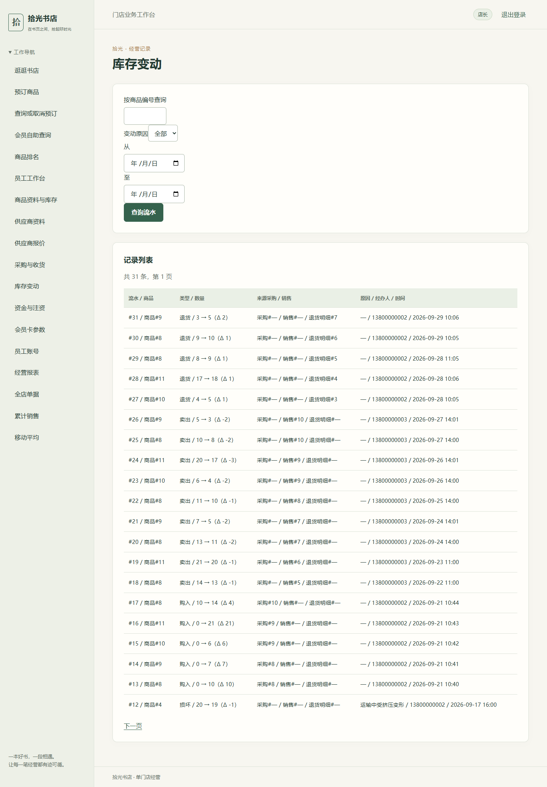
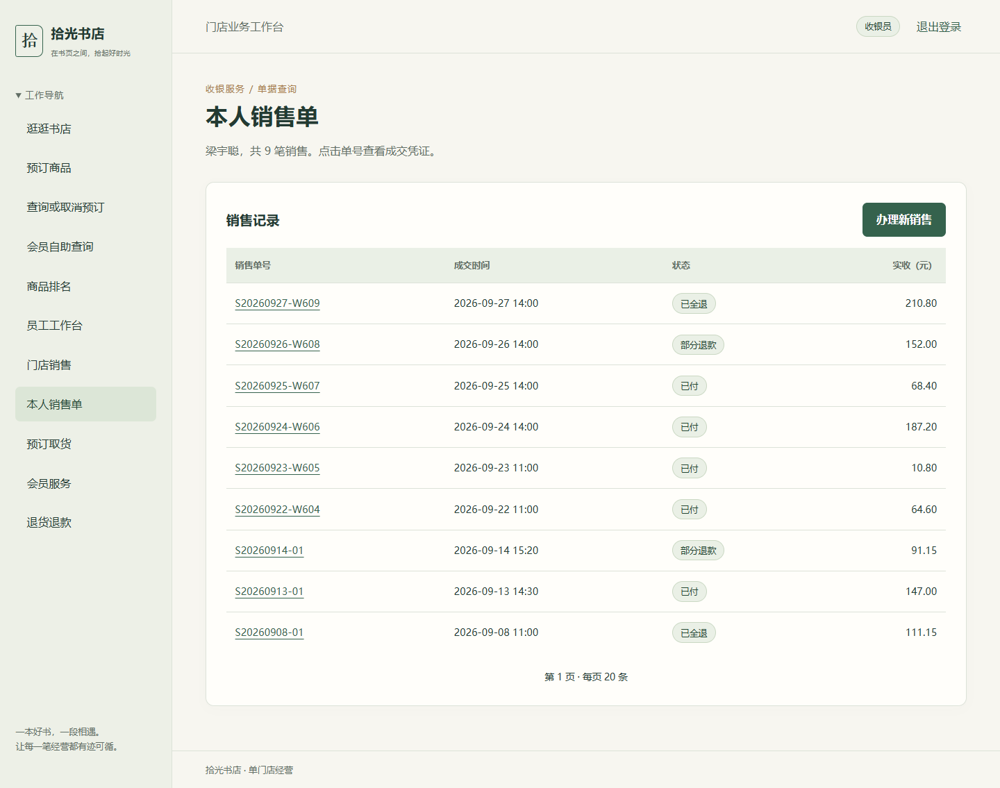
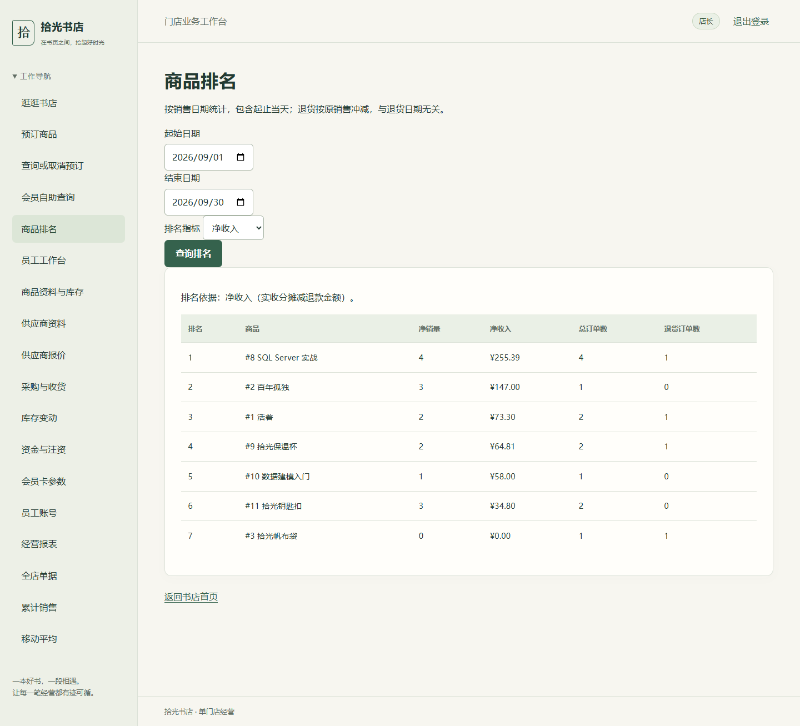
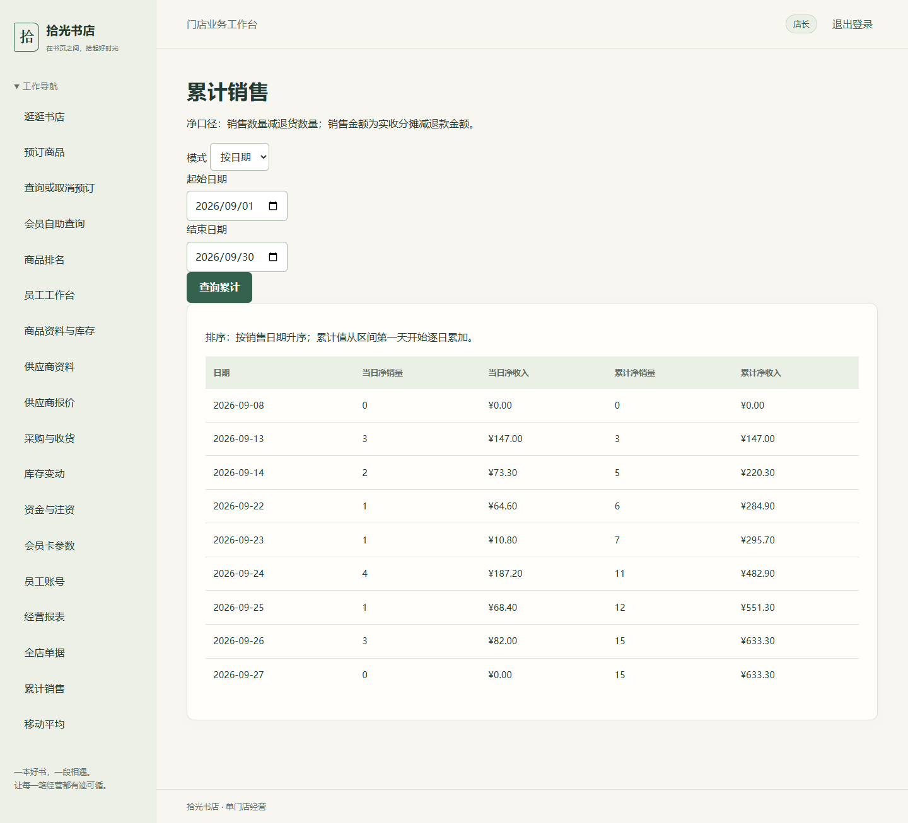
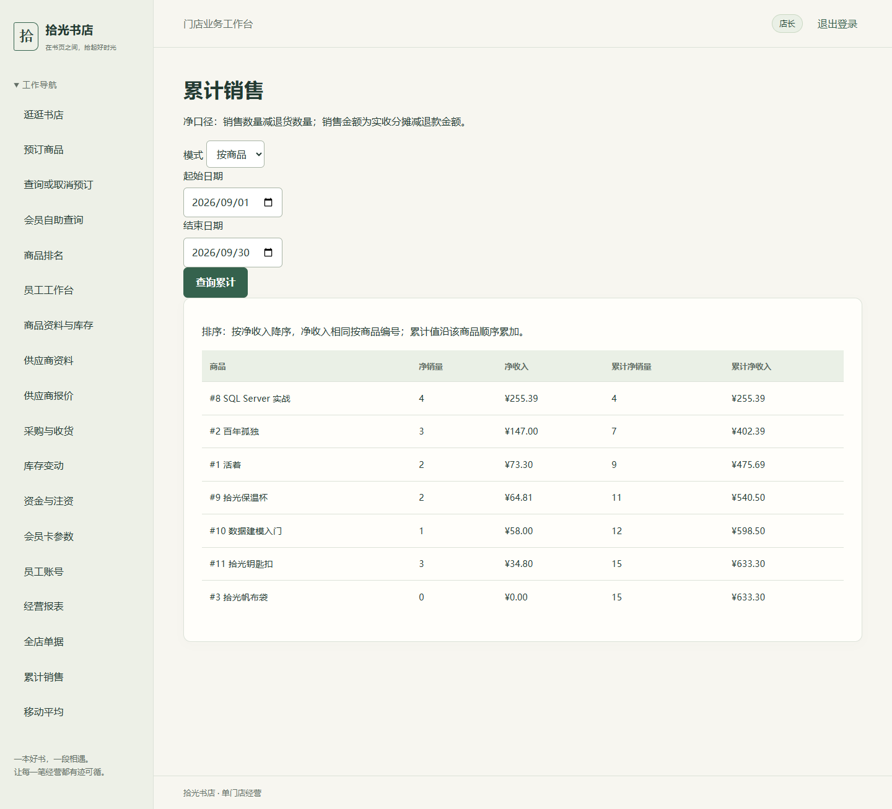
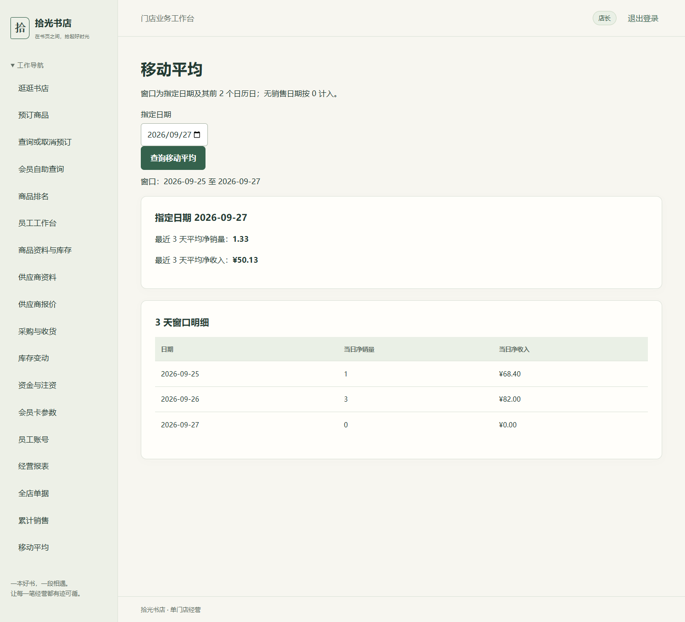
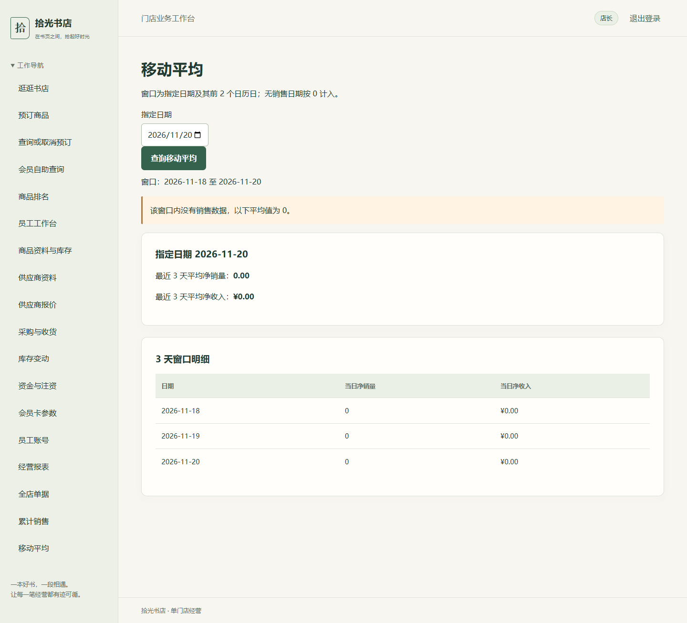
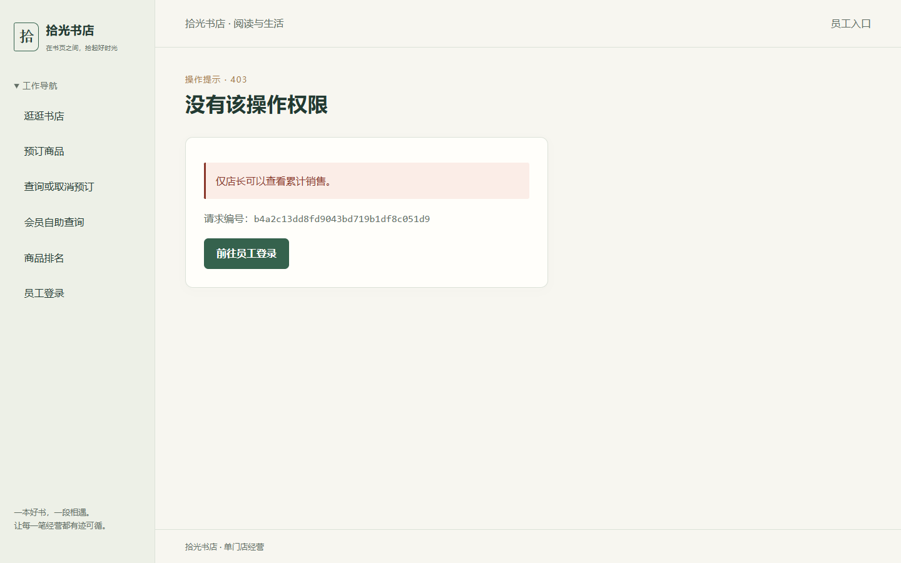

# Week11 验收结果记录

- 记录日期：2026-11-22
- 运行库：`ShiguangBookstoreWeek7StockCheck20261121`
- 测试库：测试运行器创建的 `*AuthTests*` 独立副本
- 测试命令：`.\run.ps1 test -ConfigFile run.stockcheck2.json`
- 截图：CodeBuddy 内置 Playwright（Chrome，1440×900）
- 总体结果：**133 通过，失败 0、错误 0、跳过 0**
- 结论：库存审计、订单完成校验、排名、累计、移动平均均**符合业务预期**；订单完成按助教确认不实现触发器。

## 1. 总表

| 功能 | 用例/输入 | 预期 | 实际 | 判定 | 证据 |
|---|---|---|---|---|---|
| 库存审计 | W11-T01 单条插入 | 正常写入并写流水 | PASS | 符合 | `sql-results/50-week11-trigger-cases.log` |
| 库存审计 | W11-T02 单条修改（库存减少） | 正常写入并写流水 | PASS | 符合 | 同上 |
| 库存审计 | W11-T03 多条插入 | 两行流水均通过 | PASS | 符合 | 同上 |
| 库存审计 | W11-T04 非法 after | 触发器拒绝 | `52403` | 符合 | 同上 |
| 订单完成 | 正常成交、非法明细、重复提交、回滚 | 检查通过才写入；重复不生成第二单 | 由销售/取货测试覆盖 | 符合 | `sql-results/51-full-tests.log` |
| 排名 | 净销量/净收入/净订单数 | 排名、并列、角色回退正确 | 实际见 §5 | 符合 | `47-week11-ranking-cases.log`、截图 01/03/04 |
| 累计 | 按日期/按商品 | 累计单调，最后一行等于总额 | 日期 15 / 633.30；商品 633.30 | 符合 | `48-week11-cumulative-cases.log`、截图 05/06 |
| 移动平均 | 指定 2026-09-27 | 3 天窗口、补 0、均值正确 | 1.33 / 50.13 | 符合 | `49-week11-moving-average-cases.log`、截图 07 |
| 移动平均 | 指定 2026-11-20 | 无销售显示 0 | 3 行 0、提示 | 符合 | 截图 08 |
| 权限 | 游客访问累计/移动平均 | 403 | 403 | 符合 | 截图 02、页面测试 |
| 历史基线 | Week6 artifact audit | 通过 | PASS | 符合 | `54-week6-artifact-audit.log` |

## 2. 库存审计

### 2.1 审计记录

`stock_movement` 已包含：

```text
goods_id / change_type
stock_before / stock_after / quantity
changed_by / changed_at
request_id / sale_id / return_item_id
```

截图中的实际流水示例：

```text
#31 商品#9  退货  3 → 5（Δ 2）  库管 2026-09-29 10:06
#30 商品#8  退货  9 → 10（Δ 1） 库管 2026-09-29 10:05
#29 商品#8  退货  8 → 9（Δ 1）  库管 2026-09-28 11:05
```



### 2.2 触发器验证

`dbo.tr_stock_movement_guard` 为 `AFTER INSERT ON stock_movement`，重复校验：

```text
stock_before >= 0
stock_after >= 0
quantity = stock_after - stock_before
每个商品本次最后一条流水的 stock_after = goods.stock_total
```

实际结果：

```text
W11-T01 single insert PASS
W11-T02 single update PASS
W11-T03 multiple insert PASS
W11-T04 trigger rejection PASS: 52403
```

说明：触发器不是主写入保障；主保障仍是 `usp_adjust_stock` 单事务写 `goods` 和 `stock_movement`，触发器只做重复校验。

## 3. 订单完成规则

订单完成不新增状态或触发器，已由黄智亮与助教确认。当前语义为：

```text
销售事务成功提交 = 订单完成
```

### 3.1 正常状态

销售列表实际 9 笔：

```text
已付      5 笔
部分退款  2 笔
已全退    2 笔
```



### 3.2 条件不满足与重复

| 场景 | 实际处理 |
|---|---|
| 明细为空/字段不完整/数量非法 | `52101` 拒绝 |
| 商品不存在、未上架、未定价 | `52103` 拒绝 |
| 可售量不足 | `52104` / `52302` 拒绝 |
| 积分抵扣超限 | `52105` 拒绝 |
| 报价过期或内容变化 | `52107` 拒绝 |
| 同一请求键重试 | 返回原结果，不生成第二张单 |
| 同一预订重复取货 | 预订状态检查 + `UX_sale_reservation_id` 拒绝 |
| 已完成销售再次完成 | 没有“完成销售”更新入口 |

完整测试 `133` 项覆盖正常成交、非法输入、重复提交、回滚；未发现重复单据或半成品。

## 4. 排名查询

输入：

```text
日期：2026-09-01 至 2026-09-30
指标：quantity / revenue / orders
```

### 4.1 净收入排名

| 名次 | 商品 | 净销量 | 净收入 | 总订单 | 退货订单 |
|---:|---|---:|---:|---:|---:|
| 1 | SQL Server 实战 | 4 | 255.39 | 4 | 1 |
| 2 | 百年孤独 | 3 | 147.00 | 1 | 0 |
| 3 | 活着 | 2 | 73.30 | 2 | 1 |
| 4 | 拾光保温杯 | 2 | 64.81 | 2 | 1 |
| 5 | 数据建模入门 | 1 | 58.00 | 1 | 0 |
| 6 | 拾光钥匙扣 | 3 | 34.80 | 2 | 0 |
| 7 | 拾光帆布袋 | 0 | 0.00 | 1 | 1 |



### 4.2 净销量与净订单数

净销量排名出现并列：

```text
第 1：SQL Server 实战（4）
第 2：百年孤独、拾光钥匙扣（3）
第 4：活着、拾光保温杯（2）
第 6：数据建模入门（1）
第 7：拾光帆布袋（0）
```

净订单数排名中，`SQL Server 实战` 第 1，`拾光钥匙扣` 第 2，其余净订单数为 1 的商品并列第 3；`RANK()` 保留并列并跳号，符合设计。

游客只可看净销量；店长可切换净收入/净订单数；非店长请求收入/订单数时自动回退净销量。截图 01/03/04 与页面测试一致。

## 5. 累计查询

### 5.1 按日期

区间 `2026-09-01` 至 `2026-09-30`：

```text
最终累计净销量：15
最终累计净收入：633.30
```

累计值逐日单调不减；最后一行等于区间总额。实际日期行从 09-08 开始，09-27 为最后一行。



### 5.2 按商品

按净收入降序累计；前两行：

```text
SQL Server 实战：净收入 255.39，累计收入 255.39
百年孤独：净收入 147.00，累计收入 402.39
```

最后一行累计净收入为 `633.30`，与日期模式总额一致。



## 6. 移动平均

指定日期 `2026-09-27`，窗口 `2026-09-25` 至 `2026-09-27`：

| 日期 | 当日净销量 | 当日净收入 |
|---|---:|---:|
| 2026-09-25 | 1 | 68.40 |
| 2026-09-26 | 3 | 82.00 |
| 2026-09-27 | 0 | 0.00 |

3 日平均：

```text
净销量 = (1 + 3 + 0) / 3 = 1.33
净收入 = (68.40 + 82.00 + 0.00) / 3 = 50.13
```



指定 `2026-11-20` 时窗口无销售，3 行均显示 0，并提示“该窗口内没有销售数据”：



## 7. 权限

| 页面 | 游客 | 收银员 | 库管 | 店长 |
|---|---|---|---|---|
| 商品排名-净销量 | 200 | 200 | 200 | 200 |
| 商品排名-净收入/订单数 | 回退净销量 | 回退净销量 | 回退净销量 | 200 |
| 累计销售 | 403 | 403 | 403 | 200 |
| 移动平均 | 403 | 403 | 403 | 200 |



## 8. 截图索引

| 图号 | 文件 | 角色/状态 | 说明 |
|---:|---|---|---|
| 01 | `screenshots/01-ranking-guest-quantity.png` | 游客 | 排名仅净销量 |
| 02 | `screenshots/02-guest-cumulative-403.png` | 游客 | 累计页 403 |
| 03 | `screenshots/03-ranking-manager-revenue.png` | 店长 | 排名净收入 |
| 04 | `screenshots/04-ranking-manager-orders.png` | 店长 | 排名净订单数 |
| 05 | `screenshots/05-cumulative-date.png` | 店长 | 按日期累计 |
| 06 | `screenshots/06-cumulative-product.png` | 店长 | 按商品累计 |
| 07 | `screenshots/07-moving-average.png` | 店长 | 3 天移动平均-有销售 |
| 08 | `screenshots/08-moving-average-empty.png` | 店长 | 3 天移动平均-无销售 |
| 09 | `screenshots/09-inventory-ledger.png` | 店长 | 库存流水前后数量 |
| 10 | `screenshots/10-sale-list.png` | 收银员 | 销售单与订单状态 |

## 9. 原始证据

```text
sql-results/full-test-summary.json       测试运行摘要
sql-results/full-test.log                完整测试控制台输出
sql-results/47-week11-ranking-cases.log
sql-results/48-week11-cumulative-cases.log
sql-results/49-week11-moving-average-cases.log
sql-results/50-week11-trigger-cases.log
sql-results/51-full-tests.log
sql-results/54-week6-artifact-audit.log
sql-results/window-query.txt              window_query.sql 的排名/累计/移动平均实际输出
sql-results/playwright-results.json       10 张截图的 URL、状态码、标题与判定
```

## 10. 结论与限制

- 库存审计、排名、累计、移动平均均有 SQL 用例、页面测试和截图证据，结果符合业务预期。
- 订单完成没有触发器，按助教确认以“事务提交即完成”实现；条件不满足时拒绝，重复提交不生成第二张单。
- 截图来自演示副本，不改动生产库；测试使用独立 `*AuthTests*` 库。
- 本次截图运行 `10/10` 返回预期状态码；完整测试 `133/133` 通过。
- 当前改动未 commit、未 push。
