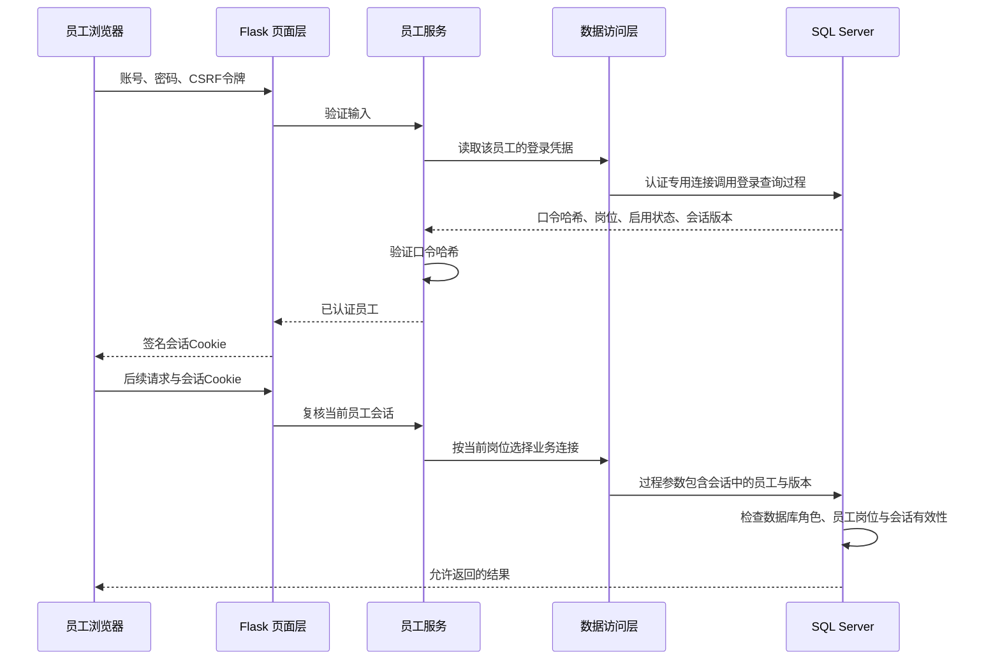

# 业务入口与权限实现方案

## 1 当前实现与分步顺序

本方案按用户选择采用 Flask 员工认证、受限数据库服务账号和存储过程入口。业务规则仍以 [业务清单](../specs/spec-businesses.md) 为准，岗位权限以 [角色清单](../specs/spec-roles.md) 为准。

第一步已经提供登录、退出、当前员工身份查询、口令哈希存储、会话失效及数据库权限基础。数据库脚本在第七周专用副本部署；第六周基线和验收入口保持历史职责。最初通过 `EXECUTE AS USER` 进行可回滚集成测试，结果见 [基础执行记录](../../db/results/week-7/entry-foundation-20261022/README.md)。2026-10-23又在 `ShiguangBookstoreWeek7EntryYourRun` 配置四个独立服务登录及员工练习口令，实际登录连接及 HTTP 流程均已验证，见[本机部署记录](../../db/results/week-7/local-deployment-20261023/README.md)。

第二步门店销售已完成：结算预览、签名确认、销售单与明细、库存、积分和资金在一个事务中提交，并提供同请求重试和本人凭证查询。48项完整测试通过，当前运行副本仅做预览检查，没有写入测试销售。设计见[门店销售入口](sale-entry.md)，证据见[销售验收记录](../../db/results/week-7/sale-entry-20261023/README.md)。

后续实现顺序：

1. 预订创建、取消、取货、过期：统一锁定和状态迁移顺序。
2. 采购、退货、会员办理、商品及参数维护：逐个动作接入并补充事务测试。
3. 其他查询权限、页面和完整流程：包括顾客信息边界。

以上后续动作尚未实现。门店销售的验收不代替到店取货、退款或其他写入流程验收。

## 2 身份从哪里来

浏览器提交的 `role`、`cashier_by`、`employee_phone` 不能作为操作人依据。Flask 会话只保存员工手机号、登录时岗位和会话版本；不保存口令或哈希。每次访问受保护入口，服务层重新检查启用状态、当前岗位及版本；过程再检查业务账号与员工岗位是否对应。

**信任边界**：这里由 Flask 保证具体员工的身份。服务数据库账号及其凭据只交给后端；数据库能够校验岗位和会话版本，但无法独立证明某个手机号确实由该员工本人登录。例如，掌握收银员服务连接和某位收银员会话版本的受信任调用者，可以传入这位收银员的手机号。过程参数和会话版本不构成独立的员工认证凭证，也不允许员工或浏览器直接拿服务连接访问数据库。

同一岗位多人共用相应服务连接，具体留痕仍使用不同员工手机号。技术服务账号不属于新增经营角色。

## 3 数据库权限分配

| 服务数据库角色 | 授予的过程 | 不授予的能力 |
|---|---|---|
| `bookstore_app_auth` | `api.usp_employee_login_lookup`、`api.usp_employee_session_lookup` | 业务过程、底表直接查询和修改 |
| `bookstore_app_cashier` | `api.usp_employee_context`、销售商品查询、结算预览、销售创建和本人凭证过程 | 底表直接读写、认证哈希查询、店长与库管过程 |
| `bookstore_app_inventory` | `api.usp_employee_context`；后续按对象授予库管业务过程 | 底表直接读写、认证哈希查询、收银与店长过程 |
| `bookstore_app_manager` | `api.usp_employee_context`；后续按对象授予店长业务过程 | 底表直接读写、认证哈希查询、其他岗位过程 |

每个服务数据库用户只加入对应的一个新应用角色，不加入历史 `bookstore_cashier` 等角色，也不加入 `db_owner`、`db_datareader`、`db_datawriter`，不具备服务器管理权限。应用每次打开连接都检查岗位角色唯一性并拒绝 `dbo`、`sysadmin` 或 `db_owner` 配置。

新角色被显式禁止直接读写 `dbo`、`auth` 模式中的表。`api` 与表所在模式都由 `dbo` 拥有，过程使用静态 SQL 经所有权链访问底表；执行上下文仍为调用者。当前没有使用 `EXECUTE AS OWNER`，也没有授予整个 `api` 模式的执行权。内部过程 `api.usp_require_employee` 不直接授权给运行账号。

历史 `db/role.sql` 用于第4/6周权限演示，仍保留原有权限。新应用账号不能复用其中的测试用户。当前尚未将历史角色转换成新角色，不得把历史角色已有的表权限写成已收回。

## 4 凭据与会话生命周期

新增技术表 `auth.employee_credential`：

| 列 | 含义 |
|---|---|
| `employee_phone` | 主键及员工外码，一名员工至多一份登录凭据 |
| `password_hash` | Werkzeug 生成的带盐口令哈希，默认 scrypt；不保存明文 |
| `enabled` | 是否允许登录和继续使用已有会话 |
| `session_version` | 重设密码、重新启用或停用时递增，使旧会话失效 |
| `updated_at` | 技术凭据最近更新时间 |

这张表属于账号机制，不向原来的19张经营表增加口令字段。第六周20张用户表的副本部署登录基础后为21张用户表，新增一个外码；第二步再新增 `api.sale_request` 请求技术表后为22表/52外码。原19张经营表结构保持原口径，实际销售经受控过程新增经营记录并同步计数。

`python -m app.manage set-password <员工手机号>` 是项目组本机部署工具，通过交互方式输入12—256字符口令。初次配置要求员工已经存在；重置或重新启用会更新哈希并递增版本。`disable` 停用并递增版本。该工具使用单独的 `BOOKSTORE_DB_ADMIN` 连接，运行服务账号无权使用它进行底表变更。它不代表店长员工管理页面已经实现。

Cookie 由 Flask 密钥签名，启用 HttpOnly、SameSite=Lax 和8小时会话期限。写请求检查 CSRF，登录后更换 CSRF 令牌。本机 HTTP 开发时 Secure 关闭，HTTPS 部署时通过配置开启。账号不存在、密码不正确、已停用均返回相同提示。

## 5 应用分层与销售入口

| 层 | 文件 | 职责 |
|---|---|---|
| 页面/路由 | `app/__init__.py`、`app/templates/` | 表单、会话、CSRF、返回页面或统一错误 |
| 业务服务 | `app/services.py`、`app/sales.py` | 登录校验、当前员工有效性及岗位检查，销售输入和签名确认 |
| 数据访问 | `app/dao.py` | 参数绑定、连接身份检查、选择岗位连接、关闭游标和连接、数据库错误转换 |
| 数据库 | `db/entry-foundation.sql`、`db/sale-entry.sql` | 凭据结构、权限、身份检查及销售事务过程 |

`api.usp_sale_create` 仅授予收银服务角色，其内部固定以“收银员”调用身份辅助过程。员工和版本来自会话；前端只提交商品与数量、会员识别信息、拟使用积分、请求键。价格、折扣、原始金额、实收金额、获得积分和操作时刻由数据库按既定规则确定。预览返回后端签名的确认令牌，确认时重新检查结算条件。

销售过程自行开启、提交或回滚一个完整事务，DAO 以自动提交连接执行这一完整过程，避免 Flask 与过程各自管理一半事务。多动作需要整体原子性时应设计专门过程，不在前端拼接一串写入。后续业务也需遵守明确的事务及锁定顺序。

## 6 环境与验收边界

本机为 SQL Server 默认实例，使用 ODBC Driver 17。2026-10-23经用户明确确认，实例已由 Windows-only 切换为 Windows + SQL Server 混合身份验证并重启，四个受限 SQL 服务登录已启用。应用示例按实际驱动配置；其他机器使用 Driver 18 时修改连接字符串即可。

现有 Windows 管理账号不能直接作为应用账号，DAO 会拒绝。本机运行连接使用四个 `bookstore_w7_yourrun_*` 登录，只映射到指定练习副本中的各自应用角色；服务口令和签名密钥保存在忽略的本地配置，员工随机练习口令另存本地文件。已经以四个独立 SQL 登录验证权限，并通过本机实际 HTTP 服务验证四名员工登录、身份查询、工作台和退出。HTTP 验证由程序执行，没有记为人工浏览器操作；Web 员工管理及业务写入仍未实现。

部署、参数配置与测试命令见 [应用使用说明](../../app/README.md)。第六周的固定快照回归只用于第六周，不作为新增技术表后的第七周全库表数验收。
