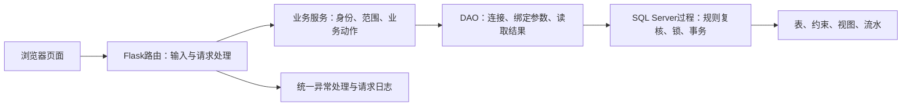

# 拾光书店 Web 开发规划

编写日期：2026-11-01。适用阶段：第7—9周 Web 应用开发及第二阶段 v1.0 交付。

2026-11-02 获准实施。本文保留开发时的范围、候选方案、实施顺序与验收目标。当前实现与技术边界见[Web 增量设计](web-model-extension.md)，实际完成情况及遗留项见[实施台账](../tasks/task-web-development.md)。

## 1. 目标、依据与完成标准

### 1.1 要交付什么

在现有 SQL Server 数据库和 Flask 应用上，完成一套可操作、可解释、可复现的书店 Web 应用。顾客可以浏览并预订；收银员可以销售、核销、退款和办理会员；库管可以管理商品资料、采购、收货和库存业务；店长可以审批、付款、定价、管理员工并查看经营账。各角色的操作须落到真实数据库，不能仅以静态页面或模拟数据作为功能完成证明。

页面需要清楚、统一、适合课堂演示，同时继续坚持项目既定原则：应用薄、数据库规则清晰、单据和流水可对账。保持单门店、线上预订到店自提、现场确认收付款的业务范围。

整体完成须同时满足：

1. 课程要求的登录、分层、商品/库存/订单及明细操作、角色差异、统一错误、参数化 SQL 和集成测试逐项有对应实现和验收证据；课程 CRUD 演示口径须按第5节落实。未解决项应公开登记，但登记不等于满足要求，存在必需项差距时只能标记为带差距的阶段交付。
2. 正式业务 B1—B15 的适用动作均有真实入口，不能以“该角色能登录”代替业务流程完成。
3. 单头、明细、库存、已订量、积分和资金的变化符合正式规则；失败不留半笔，重复不重复记账，并发不超卖或超退。
4. 从仓库与已安装的先决软件出发，按手册可准备、启动和验收，保留第5—6周全部成果。
5. 正常操作、错误操作、多角色流程、复现结果和实际分工都有证据；AI 执行与人工审阅分别记录。

### 1.2 依据及优先级

| 依据 | 用途 |
|---|---|
| [第7—9周任务原件](../../homework/第7-9周任务讲解.docx) | 课程要求及阶段交付清单，含“至少区分店员和顾客两类角色” |
| [业务与规定](../specs/spec-businesses.md)、[角色](../specs/spec-roles.md) | 15条业务、R-1—R-26及操作权限，决定业务语义 |
| [数据字典](../specs/spec-data-dictionary.md)、[数据边界](../specs/spec-data-boundary.md) | 字段、关系、约束和入库边界；实际部署还须对照迁移脚本 |
| [规范化说明](../design/design-normalization-v1.0.md)、[第六周验收](../reviews/review-week-6.md) | 已完成的数据库设计、迁移结论及保留范围 |
| [入口权限](../design/entry-permissions.md)、[销售方案](../design/sale-entry.md)、[统一入口](../design/unified-entry.md) | 延续已采用的技术和信任边界 |
| [后续操作指南](../design/next-steps-guide.md) | 已识别的复现缺口和待开发事项，作为本文任务来源 |
| 当前 `app/`、`db/`、`scripts/`、`tests/` | 判断实际实现状态；历史说明与源码不符时先核对，不擅自改经营规则 |

课程要求与业务口径须同时满足。本文可以确定工程默认值，不能用工程建议覆盖正式经营规定；发现冲突须记为具体差距，给出解决方案后处理。

课程截止为**第10周周二23:59**。仓库未提供课程周历，本规划不推算公历截止日，实施时按课程通知核对。

## 2. 当前项目的真实起点

以下为源码阅读和已有归档所得，本次编写规划未连接数据库、未重跑应用测试，也未核实本机服务当前是否运行。

| 项目 | 已有内容 | 后续工作 |
|---|---|---|
| 技术栈 | Python 3、Flask、Jinja2、pyodbc、SQL Server；无 ORM、无前端构建工具 | 在原栈增量开发 |
| 数据模型 | 19个经营实体，第六周迁移及样例、约束、回归和 ER 材料已保留 | 新能力优先复用；必要结构扩展采用增量迁移 |
| 员工认证 | 登录/退出、哈希口令、CSRF、会话版本、受限服务连接 | 完成店长页面管理及更多角色业务 |
| 销售 | 收银选货、预览、签名确认、原子结算、本人销售凭证、请求幂等 | 增加列表和工作台，复用结算规则支持到店取货 |
| 权限 | auth/cashier/inventory/manager 四类后端服务身份 | 按功能逐项授权；顾客和自动任务增设专用最小权限身份 |
| Web 外观 | 简单 HTML 模板，工作台只提供收银销售入口 | 建立公共布局、统一样式、各角色导航和操作反馈 |
| 统一入口 | `run.ps1` 的 setup、doctor、test、start、verify | 补齐新库对象检查及各新增业务的部署/测试/诊断 |
| 测试归档 | 统一入口归档为26项非数据库测试、58项完整测试通过 | 这是历史结果，不能证明后续功能或本次运行通过 |
| 尚未实现 | 顾客端、采购、报损、预订/过期/取货、退货、会员办理、经营设置/报表等入口 | 按第11节逐个闭环实现 |

已有部署记录为22张用户表、52个外码、10个 `api` 过程，其中经营实体仍为19个。技术对象数量可以随开发变化，应以当次部署清单核对，不能把历史数量永久写死。

**优先修复的已知问题：** `scripts/project_runner.py` 的 `prepare_source()` 清单未安装 `constraint.sql` 中的 `dbo.tr_card_type_cross_row` 及 `view.sql` 中的三个视图。数据指纹一致和旧测试通过不能证明这些对象齐全。另有请求日志字段、约束错误分类及 API 404/405 统一响应需要补齐。

## 3. 范围与实现原则

### 3.1 v1.0 必须覆盖的业务

| 业务 | 应用入口及结果 | 当前状态 |
|---|---|---|
| B1 商品建档、定价与上下架 | 库管建档及报价维护；店长定价、调价、上下架 | 待开发 |
| B2 商品采购 | 草稿和明细维护、提交、取消、审批、一次付款、一次收货 | 待开发 |
| B3 商品报损 | 库管按可售量登记数量及必填原因，写库存流水 | 待开发 |
| B4 门店销售 | 选货、预览、收款确认、销售凭证 | 已有，需整合样式和列表 |
| B5 线上预订与取消 | 顾客预订、凭证查询/取消、收银代取消、到期自动释放 | 待开发 |
| B6 到店取货 | 收银核验手机号与预定码、整单预览并收款交付 | 待开发 |
| B7 商品退货 | 收银按原单受理部分/全部退款；库管独立回收入库 | 待开发，交接方案见第10节 |
| B8 会员办理 | 开卡、同档重买/续期、升级、过期重买及办理收费记录；联系方式维护按第10节落实 | 待开发 |
| B9 会员卡档位配置 | 店长维护银卡、金卡当前费用与折扣 | 待开发 |
| B10 员工与账号管理 | 店长维护员工、岗位、启停和重置凭据 | 仅部署 CLI 已有 |
| B11 商品与库存查询 | 顾客公开商品；员工按权限查看内部库存 | 仅收银选货读取已有 |
| B12 库存变动查询 | 库管/店长按商品、原因、时间及来源单据追溯 | 待开发 |
| B13 单据与自助查询 | 各角色按范围查单；会员验证后查本人单据/积分 | 本人销售凭证已有，其余待开发 |
| B14 资金收付登记 | 业务自动流水；店长只手工登记注资/提现 | 自动销售收款已有 |
| B15 盈亏查询 | 店长看业务收支、经营盈亏、现金余额及来源明细 | 待开发 |

“必须覆盖”表示按本规划实施的最终范围。第11节中间里程碑是阶段产物，不降低最终完成标准。

### 3.2 工程默认值

- 使用 Flask + Jinja2 服务端渲染，公共 CSS 和少量原生 JavaScript；API 与页面复用同一业务服务。
- 使用 Flask Blueprint 按模块整理路由，不把全部业务继续堆进应用工厂；采用组合与小模块即可。
- 保留 pyodbc 和显式参数绑定。新增运行时 SQL Server 访问集中在 DAO 层；部署脚本、运维工具和隔离测试属于另外的执行环境。
- Python 服务层负责输入、身份、操作范围及流程组织；数据库存储过程负责关键规则复核、锁定和原子写入。避免在两处实现互相漂移的结算算法。
- 所有真实金额使用 SQL `DECIMAL` / Python `Decimal`；API 建议以十进制字符串输出金额，JavaScript 不负责计算权威成交额。
- 选定一个门店时区并统一配置。建议 `Asia/Shanghai`，按现有 `DATETIME2` 数据含义确定兼容方案，不能把历史门店时间突然解释为 UTC。会员到期按门店当地日期，预订到期按门店时间精确判断。
- 保留本机演示的根目录入口和默认端口5000。页面静态资源本地提供，不依赖 CDN、外部字体或在线图表才能演示。

本阶段不增加配送、多门店、购物支付网关、储值、二手书、供应商登录或独立系统管理员。顾客购买仍通过门店收银或预订后自提完成。

## 4. 页面结构与界面设计

### 4.1 视觉和交互默认方案

品牌继续使用“拾光书店”。顾客端采用暖白底、深色正文、低饱和绿色操作色和少量木色点缀；员工端沿用相同色彩，以清楚的表格、单据和状态信息为主。图书封面不是现有数据的必填要求，可先用本地统一占位展示，不伪造商品素材。

桌面端员工页面使用侧边导航、顶部身份区、内容区；手机端导航折叠，表格可横向滚动，结算和确认按钮可直接操作。顾客端优先适配360px以上屏幕，员工端同时检查约1440px桌面视口。

公共组件包括：按钮、输入/选择、字段提示、搜索筛选、分页、状态标签、明细表、金额汇总、确认对话、空状态、错误页、成功凭证及打印样式。状态标签必须含文字，不能只靠颜色表达。

重要交互约定：

- 必填项与格式错误在字段附近提示；服务端校验仍是最终依据。
- 收款、退款、付款、报损、取消、停用账号等动作先展示业务后果，再确认提交。
- 涉及金额的销售/取货、采购付款、会员办理、退款、注资/提现统一遵循第8.4节的预览与确认合同。
- 写入后采用303跳转或等效结果页，刷新不重复写入；提交期间禁用按钮只是交互，幂等仍由后端保证。
- 超时或结果不确定时保留原请求标识并提供查询/重试，不引导用户为同一笔钱重新开单。
- 列表保留筛选条件，默认每页20条、最大100条；排序字段白名单映射，不能拼接用户输入。
- 商品缺货显示“暂时无货”；不自行新增商品状态机。会员已过期、无积分等情况以业务提示说明。
- 凭证展示单号、时间、明细、金额及必要经办信息。错误页只显示友好说明和请求编号，内部结构放开发文档及日志。

### 4.2 页面导航

```text
顾客：商品浏览 → 商品详情/待预订清单 → 提交预订 → 预订凭证
      凭证查询 → 预订详情/取消
      会员验证 → 本人会员信息/积分/销售及退货单

员工登录 → 按岗位进入工作台
  收银员：门店销售｜预订核验与取货｜退货受理｜会员服务｜本人单据
  库管：商品资料｜供应商及报价｜采购与收货｜报损｜退货回收｜库存与流水
  店长：待办｜定价与上下架｜采购审批/付款｜会员卡参数｜员工账号｜资金与盈亏
```

保留现有 `/auth/login`、`/sales/new` 和销售凭证路径。建议新增 `/shop` 作为顾客首页；`/` 有员工会话时进入相应工作台，无员工会话时进入顾客首页，并保留明显的“员工入口”。改动根页面跳转后需同步旧测试和手册。

### 4.3 页面与权限合同

下表路径均为拟定路径，实施时可合理归并页面；动作和权限不得因此遗漏。

| 页面/路径 | 可用角色 | 关键内容及操作 |
|---|---|---|
| `/shop`、`/shop/goods/<id>` | 顾客 | 已上架商品、公开资料、当前售价、有货状态；加入待预订清单 |
| `/shop/reservations/new` | 顾客 | 手机号、商品/数量、三天有效期说明；不收款 |
| `/shop/reservations/lookup`、详情页 | 凭证验证后的顾客 | 手机号+预定码查询、取消、终态说明；不提供全站查单 |
| `/shop/member` | 归属验证后的会员 | 当前权益、积分流水、本人销售及退货凭证 |
| `/workspace` | 三类员工 | 当前岗位、可执行动作和与本岗相关的待办 |
| `/sales/new`、`/sales/<no>`、`/sales` | 收银员 | 现有销售闭环、本人经手列表/凭证 |
| `/pickups` | 收银员 | 凭证核验、整单预览、确认收款、代取消 |
| `/returns/new`、`/returns/<no>` | 收银员 | 凭原单号受理专用视图、剩余可退量、退款预览及凭证 |
| `/members`、办理页面 | 收银员 | 按手机号查权益、办理/升级/续期、收费预览和凭证；联系方式维护须先落实第10节身份关联方案 |
| `/goods`、`/goods/new`、商品编辑页 | 库管 | 商品资料及图书/文创属性，不能改售价和库存 |
| `/suppliers`、报价页 | 库管 | 供应商资料、当前报价和关联商品 |
| `/purchases`、新建/详情页 | 库管、店长，动作分权 | 草稿明细、提交/取消、审批、付款、收货；终态只读 |
| `/inventory` | 三类员工 | 在架总量、已订量、可售量和上架标记，只读计数 |
| `/inventory/movements`、`/inventory/damage` | 库管；店长仅查流水 | 来源单据追溯；报损数量和必填原因 |
| `/returns/receiving` | 库管 | 待回收退货、核对原行、一次确认入库 |
| `/management/goods` | 店长 | 参考供应商报价定价、调价、上下架 |
| `/management/card-types`、`/management/employees` | 店长 | 两档当前参数；员工与凭据管理 |
| `/management/finance`、`/management/reports` | 店长 | 注资/提现、资金流水、业务收支、盈亏和现金余额 |
| `/management/documents` | 店长 | 跨业务单据查询与来源追溯，不修改既成内容 |

顾客接口不返回采购价、精确库存计数、员工信息、全店单据或经营账。库管不看经营盈亏，收银员不看采购价和全店销售列表。店长能看经营信息，不意味着拥有其他岗位的收款、收货操作权限。

## 5. 课程 CRUD 要求如何落地

正式业务规定已明确：课程“订单/订单明细”对应 `sale` / `sale_item`。成交后不可改数量、金额和折扣，不能以删除事实记录实现 CRUD。

| 对象 | 查询 | 新增 | 修改 | 必要删除及边界 |
|---|---|---|---|---|
| 商品 | 内部列表/详情、顾客公开列表 | 库管建档及对应图书/文创属性 | 库管资料维护；店长定价、上下架 | 默认下架保留引用。未被引用的误建档案是否物理删除，见第10节 |
| 库存 | 员工计数、库管/店长流水 | 新商品零计数；采购/退货业务增加在架量 | 销售、报损、预订等事务更新相应计数 | 不提供删除库存流水或直接删计数入口 |
| 销售订单 | 本人销售列表/详情；店长查全店；会员验证后查本人 | 收银确认后创建单头 | 成交前待结算内容可编辑；成交后仅退款引起合法状态迁移 | 成交前清空待结算内容；已成交单保留，通过退货冲销 |
| 销售订单明细 | 凭证明细及剩余可退数量 | 结算时与单头同时创建 | 成交前改商品/数量；成交后以新退货明细表达纠正 | 成交前移除一行；成交后不删除原行 |
| 采购草稿/明细 | 库管/店长按权限查询 | 草稿及行新增 | 仅草稿可改；提交后按业务状态流转 | 草稿可移除行；单据取消保留，不物理删除已成立单据 |
| 预订单/明细 | 凭证查本人；员工限定用途 | 原子创建并锁货 | 有效转已取/已取消/已过期 | 取消释放已订量，保留原单和明细 |

销售的“成交前内容”推荐先采用服务端会话中的待结算清单，持久销售表只在确认后写入。需让页面实际支持增行、改数量、删行及整体清空，并在操作手册明确这与持久单据的区别。

**课程验收差距须公开：** 上述方案保证业务事实不可变，但“成交前清单编辑/删除”不等于对已持久化 `sale` / `sale_item` 做 SQL UPDATE/DELETE；采购草稿操作也不能替代销售表要求。如果教师要求直接演示订单及明细的持久化编辑/删除，需确认允许的未成交草稿模型后新增独立草稿结构/迁移，不能暗改成交状态枚举或破坏历史快照。未核实时不宣布字面上的销售四类 SQL 操作全部满足。

**D0 课程操作映射检查点（P0之后、相关持久化方案实施前）：** 项目组须对照课程原件确定演示方案，记录确认人、日期、依据及结论。优先说明以成交前编辑、成交后冲销满足业务意义的操作要求；如仍有验收歧义，由项目组向教师核对。若要求持久草稿增删改，须确认独立销售草稿及明细是否被接受，再补结构、转换事务及测试；增加草稿表本身不能证明符合对 `sale` / `sale_item` 的验收要求。未解决时可推进公共基础和其他业务，但不得锁定相关数据库扩展方案或勾选“课程 CRUD 已满足”。

## 6. 分层、模块与接口规划

### 6.1 文件组织

保留当前入口与兼容导入，按功能增量整理；下列为目标组织建议，不要求第一步一次性搬迁所有文件。

```text
app/
  __init__.py               应用工厂、配置、注册路由/异常处理
  errors.py                对外错误模型与集中映射
  dao.py                   连接、身份/目标库检查、公共DAO能力
  services.py / sales.py   保留已有服务，逐步整理模块
  routes/                  auth、shop、sales、inventory、purchase、manager等
  business/                各业务服务与输入合同
  data/                    分模块DAO，仅经统一连接管理访问数据库
  templates/               公共base、组件及按角色/业务分组的页面
  static/css/app.css       公共样式与打印样式
  static/js/               表单交互、明细编辑、API调用
  jobs/                    过期任务CLI及循环执行器
db/
  *-entry.sql              各业务过程和逐项授权
  application-*.sql        当前应用必需对象安装/检查，具体命名实施时确定
  migrations/              新能力的增量迁移及前置检查
  tests/                   新业务规则、事务、权限和并发验证
tests/                     服务、路由、真实SQL Server集成及工作流测试
docs/                      设计、任务、手册、验收、报告、实际分工
```

使用模块拆分是为了可读性。运行代码不得散落新的 `pyodbc.connect()` 到路由或业务层，授权也不得为省事扩成整个 `api` 架构可执行或底表可读写。

### 6.2 调用及事务责任



查询示例：顾客商品列表 → shop路由 → 公开查询服务 → 顾客DAO → 公开商品过程，只投影允许字段。

修改示例：收银确认取货 → pickup路由 → 会话/凭证及签名确认服务 → 收银DAO → 取货过程，在一个事务中复核预订、写销售与明细、释放已订量并减少在架量、记积分/资金与成功请求结果。

沿用现有销售模式：一次原子业务优先由一个过程持有事务，DAO使用受控连接调用，负责连接/游标释放与异常转换。不要在服务层另开连接分段完成同一笔业务，也不要让 Python 提前提交一半后再执行下一段。未来确需多条 SQL 共事务时，只能由 DAO 明确持有同一连接并统一提交/回滚。

### 6.3 API 范围

下表为动作合同，不强制照搬每个 URL；已有销售 API 保持兼容。页面可使用同一业务服务的表单路由，涉及动态明细/查询的交互调用对应 API，避免两套规则。

| 接口组 | 主要动作 | 必须限定的输入/输出 |
|---|---|---|
| `/api/me`、员工认证 | 当前身份、登录/退出 | 身份来自会话；口令/哈希不返回浏览器 |
| `/api/shop/goods` | 公开搜索与详情 | 仅上架商品和公开字段；缺货不泄露精确库存 |
| `/api/shop/reservations` | 创建、凭证验证后读取/取消 | 手机号、商品/数量、请求键；预定码不放URL或普通日志 |
| `/api/sales`及现有预览 | 商品、结算预览、确认、本人列表/凭证 | 复用已有签名确认；金额/操作人不采信前端 |
| `/api/pickups` | 核验、预览、确认、代取消 | 手机号+码、会话、原请求键；只整单取货 |
| `/api/goods`、`/api/suppliers`、报价 | 建档及限定字段维护 | 库管仅可提交资料/报价，店长处理价格和上架 |
| `/api/purchases` | 草稿/行、提交、取消、审批、付款、收货 | 按状态和角色分动作；单供应商、付款/收货均一次 |
| `/api/inventory` | 计数、流水、报损 | 库存计数只读；报损仅库管且必填文字原因 |
| `/api/returns` | 原单核验、预览、退款、回收入库 | 限定原单/原行、剩余可退量、实际退款与回收岗位 |
| `/api/members`、`/api/shop/member` | 办理、权益、自助查询 | 员工按职责；顾客须另验归属，不接受手机号即授权 |
| `/api/management/*` | 定价、卡参数、员工、注资提现、报表 | 店长限定动作；不可任意修改余额、积分和成交快照 |

新增 API 成功结果沿用 `{"data": ...}`；列表在 `data` 中包含记录和分页信息。错误保留现有 `error.code` / `error.message` 并补 `request_id`，例如：

```json
{"error":{"code":"insufficient_stock","message":"可售量不足，请调整数量后重试。"},"request_id":"服务端生成的请求编号"}
```

GET 仅查询，写动作使用 POST/PATCH/DELETE 等合适方法并校验 CSRF；内容类型不符、畸形 JSON、过大请求和非法分页参数均归为明确错误。新表单沿用隐藏 CSRF，新 JS 调用携带 `X-CSRF-Token`。

## 7. 身份、权限、错误与日志

### 7.1 权限链

员工继续使用当前三种岗位，一人一岗。浏览器不指定审批人、收货人或退款人；后端会话确定身份，服务层复核范围，数据库过程再次校验岗位与会话版本。

顾客是独立权限主体，不作为 `employee.role` 新增枚举，不借用收银服务连接。拟新增顾客服务角色，仅授予公开商品、创建预订、凭证查询/取消及已验证会员自助所需的具体过程。自动过期任务使用独立角色，只能调用到期处理过程。相应扩展 DAO 的角色唯一性检查、配置、setup、doctor、test 和秘密文件管理，不能直接把新角色接入现有四角色检查而遗漏验证。

顾客凭手机号+预定码访问预订，不需要建设完整注册体系。新预定码应采用密码学随机源，在现有 `VARCHAR(20)` 范围内生成足够难猜、唯一且便于抄录的代码；旧六位样例只作历史样例，不能当成新码生成标准。凭证通过POST提交并建立短期、限定资源的会话，避免长期出现在URL、访问日志或浏览器历史中。增加验证尝试限制和统一失败提示。

会员查询的身份方案与退货专用查询范围见第10节；均不能以单独输入手机号获得他人信息。

### 7.2 集中错误分类

| 情形 | 建议HTTP状态 | 对外说明 |
|---|---|---|
| 参数/格式/范围错误 | 400 | 指出可纠正的业务字段，不显示原始数据库值 |
| 未登录、会话失效 | 401 | 提示登录；页面跳转需保留合理返回位置 |
| 岗位不足、CSRF无效 | 403 | 无权操作或页面已过期 |
| 不存在、无权获知的他人单据 | 404 | 统一“记录不存在或不可访问”，避免枚举 |
| 库存不足、非法状态、请求内容冲突 | 409 | 明确重选、刷新或回到原结果 |
| 数据库唯一/FK/CHECK等冲突 | 409或已映射的400 | 按业务语义映射，不能全归成数据库连接失败 |
| 数据库连接不可用/超时 | 503 | 暂时不可完成，提供请求编号 |
| 未预料程序异常 | 500 | 统一系统提示，详细原因仅在后端 |

API 的404/405、框架异常和预期业务错误都经统一出口处理。页面错误复用公共模板，避免任意业务错误都退回登录表单。死锁和锁超时按动作分类；结果不确定的写请求只允许用原请求键重试。

### 7.3 日志与业务留痕

后端按请求记录：请求编号、时间、动作、主体类别/岗位、脱敏主体标识、错误码、处理结果和耗时；异常含受控堆栈以便定位。不得记录口令、哈希、数据库连接串、Cookie、CSRF、完整预定码、会员凭证及签名确认令牌。响应头和错误结果提供同一请求编号。

技术请求日志用于诊断，不等于新增经营审计表。正式角色文档对操作人/时间、自动动作无员工身份、只查询不记经营留痕及不做字段级前后快照的边界继续有效。

## 8. 数据库、状态机与一致性

### 8.1 开发前先校准数据库基线

梳理建表、样例、约束、视图、迁移、扩展样例、应用过程及授权的依赖。`constraint.sql` 和 `view.sql` 含安装之外的测试/演示语句，先核对执行效果；必要时提取当前应用的安装入口，历史课程脚本及证据保留原职责。

空库准备和 doctor 应校验：必要表/列/索引、启用的 `tr_card_type_cross_row`、`v_sale_detail`、`v_goods_sales_summary`、`v_inventory_status`、已部署过程和精确授权。另在隔离库验证金卡费不高于银卡、金卡折扣率高于银卡确实被拒绝，不能只查对象名。

已有经营副本升级应先检查版本和目标库，再执行增量迁移；不得重装固定样例或按历史固定行数断言运行数据。安装/迁移需要可重复运行或明确版本标记，失败时有恢复说明。

### 8.2 状态与事务边界

| 动作 | 必须同事务完成的内容 | 核心限制 |
|---|---|---|
| 门店销售 | 销售头/行、在架扣减、库存流水、积分/资金、成功请求记录 | 复用已有流程与R-7快照，不绕过预览复核 |
| 创建预订 | 预订头/行、已订量增加、成功请求记录 | 在架量不变，不计金额/积分/资金 |
| 取消/过期 | 有效状态迁移、已订量释放、相应请求结果 | 不扣在架、不生成资金/库存变动流水 |
| 到店取货 | 核验有效预订、生成销售、已订量和在架量同步减少、各流水、预订置已取 | 复用当时结算规则，整单取货，一次完成 |
| 采购付款 | 审批及未付检查、资金流水、成功请求记录 | 审批后、收货前，按批次价一次付清 |
| 采购收货 | 已付款校验、按行足量增加在架、库存流水、置已收货、请求结果 | 不分批，不能伪造收货人 |
| 报损 | 可售量检查、在架减少、原因与库存流水、请求结果 | 不损坏已订量，原因必填 |
| 会员办理 | 办理历史、会员档位/有效期、费用收款、请求结果 | R-17/18/24，改配置不改旧收费 |
| 退货退款 | 原单行锁定、退货头/行、累计限额、销售状态、资金/积分回滚、请求结果 | R-25；退款阶段不提前增加实物库存 |
| 退货回收 | 交接校验、回收事实、在架增加、库管库存流水、请求结果 | 与退款关联且每行只回收一次；回收事实优先复用现有库存流水，见第10节 |
| 注资/提现 | 资金余额链、流水、登记人、请求结果 | 店长只能手工登记这两类 |

采购沿用草稿→已提交→已审批→已收货；仅草稿/已提交可取消。付款由关联事实判断，不擅自增加经营状态。预订沿用有效→已取/已取消/已过期三个终态。销售沿用已付/部分退款/已全退，状态变化不允许改成交快照。

### 8.3 幂等、并发与对账

每个写动作确定请求键、可信主体、动作类型、规范化内容摘要和原结果。成功记录与业务写入同事务提交；同键同内容回原结果，同键不同内容拒绝。先审查现有 `api.sale_request` 的能力，再选择复用公共机制或新增动作请求表，不为每个页面随意另造规则。顾客创建时也要有稳定请求键，不能仅靠下单后才获得的预定码防重。

跨过程采用一致锁定次序。当前 `api.usp_sale_commit` 先锁请求记录，调用 `api.usp_sale_calculate` 时先锁会员及读取卡参数，再按商品ID升序锁商品/库存，随后处理资金串行资源；不能将“先库存、后会员”当成现有基线。实施前按销售、取货、退款、回收、会员办理、卡参数修改和到期处理列出资源与锁顺序表，包含内部过程、触发器和外键检查的影响。优先兼容现有顺序；确需调整时统一修改相关路径并回归，不让单个新过程反向取锁。

同一预订的取消、过期和取货必须竞争同一预订记录；同一原销售的退款必须竞争同一原单记录。预订/原单锁与会员、商品、资金锁之间的顺序须在上述表中明确，避免过期批次先锁商品再等待取货持有的预订。数据库唯一约束与条件更新作为最终防线，不能只依赖应用内存锁。

持续验证以下不变量：

- 可售量 = 在架总量 − 已订量，且 `0 ≤ 已订量 ≤ 在架总量`。
- 已订量 = 全部状态为“有效”的预订行数量之和；对已经到期的有效单，在处理后完成状态与计数修复。到期判断本身不能只看旧状态。
- 在架量 = 库存变动累加；预订/取消/过期不写在架变动。
- 积分余额 = 积分流水之和；退货允许按规则产生负积分，不能手工改余额。
- 销售和退款的单头金额 = 明细及快照计算结果；全退累计退款/回滚积分恰好达到原单目标。
- 每笔资金变动前余额与上一笔后余额相接；自动业务收付可追到来源单据，零额退款/积分不写零流水。

### 8.4 涉及金额的预览与确认合同

销售/取货、采购付款、会员办理、退货退款、注资/提现均须在提交前展示服务端计算或校验后的金额、作用对象和业务后果。预览只读，不占用跨请求事务或长期锁；确认在新事务中复核身份、状态、金额及相关配置。不可变采购明细不需要虚构动态价格，但仍须复核审批、未付与资金条件。

确认凭据须绑定主体、动作、对象、规范化输入、必要的结算快照及有效期；具体实现可沿用签名令牌或服务端记录。费用、折扣、可退量或影响结果的条件变化时返回明确冲突并要求重新预览，不静默按新金额执行。余额等前置条件失效时拒绝且不留半笔。前端计算结果不作为权威值。

同一成功请求的幂等结果应在重新计算业务条件前识别，并在当前身份授权有效的前提下返回；不能因原预览已过期或后续改价而把成功请求重新执行。验证失败可修正后重新预览，未知结果须保留原请求键查询/重试。更改已成功请求的输入必须作为另一笔明确的新业务处理。

### 8.5 退货总额与明细分摊

R-25是本次总退款与总回滚积分的唯一计算口径，不能先逐行四舍五入再相加替代总额公式。推荐按原销售明细ID升序计算：设此前累计退回原价小计为 `T0`，本次第i行原成交单价乘退货数量为 `ti`，令 `Ci = T0 + Σ(t1…ti)`、`C0 = T0`；定义 `F(C) = ROUND(A × C / S, 2)`，第i行退款为 `F(Ci) − F(Ci−1)`。由差分保证本次各行合计恰好等于R-25的总退款，排序由后端固定，不受客户端行顺序影响。`S`、`A`、`E`分别沿用R-25的原价小计、原实付、原获得积分。

积分仍按整次退货计算 `floor(E × C末 / S) − 此前累计回滚积分`，不为展示方便新增无需求的逐行积分字段。明细分摊方案属于对现有公式的补充，应在P5前写入正式数据口径，明确这是本次处理顺序下的分摊，并非原销售时已经冻结的逐行实付。

测试至少覆盖多行分币尾差、颠倒输入顺序、同一原行多次部分退货、零退款行、最终全退及并发退款。现有商品售价要求大于零，但历史或异常销售数据的 `S <= 0` 仍须有明确防御处理，不直接除零或擅自制定退款政策。销售单头对账按原价明细、折扣及抵扣公式计算，不能误把原价明细之和当实付；退货单头退款须等于退货明细退款合计及对应资金金额，零额时按规则不写资金流水。

## 9. 自动过期任务与运行配置

采用独立进程执行预订过期任务，避免把线程直接塞进 Flask 请求进程，或因调试重载/多进程重复调度。拟提供 `expire-once` 和循环模式，默认每60秒扫描一批，具体参数写进配置；多实例并发执行也应安全。

任务只连接明确指定的当前应用库，只能执行到期处理过程。过程按数据库可信时间复核 `expires_at`，条件迁移并释放已订量，失败回滚、记录并下轮重试；不使用虚构员工身份。取货等关键入口须即时判断到期，不能因等待下一轮扫描而允许过期取货。库存查询/创建流程需设计到期清理协作，避免长期占住过期库存。

运行入口需同时覆盖任务的启动、停止、状态和日志。建议 `run.ps1 start` 管理 Web 与任务子进程的共同生命周期，并保留独立任务命令用于演示/排查；Ctrl+C应回收本次子进程。由实施者选择具体实现，不注册整机计划任务或开机服务作为默认要求。

在独立配置增加顾客/任务连接及必要参数时，提供兼容检查、无秘密示例和升级手册。已有配置只读诊断不能伪装成配置齐全，不自动重置原四名员工口令。

**P3前须确认的经营边界：** R-11仅写“三天”，实施前核对现有脚本与样例，确认它表示创建后72小时还是某个自然日结束。推荐创建时按门店时间加3天写定 `expires_at`，以数据库可信时间 `now >= expires_at` 判为到期；该建议尚未成为正式口径。页面展示具体到期时间，并覆盖跨日、月末和恰好到期的测试。

预订后商品下架的处理也须落实：现有销售计算拒绝未上架商品，直接复用会阻止取货。推荐遵守R-1，下架时不自动取消既有预订，阻止新销售/新预订；既有预订保留数量和原到期时间，凭证页提示暂不可取货，可按原流程整单取消或等待重新上架后在有效期内取货。若选择允许下架后履约，须先明确修改R-1及专用授权范围，不能在取货过程暗中绕过上架检查。此项决策未落实时，仅推进不依赖它的P3工作。

取货计算须区分“本单已订量”与其他顾客的已订量：只可消费本单保留数量，不能直接套用门店销售的可售量检查，也不能先在事务外释放预订再销售。到期释放协作须有明确执行入口和批次上限；公开GET不偷偷写库，顾客连接不额外获得任意到期处理权限。任务停滞时通过状态/日志暴露延迟，恢复后可重试清理；不得仅在页面上忽略过期预订而让计数与数据库事务判断矛盾。

## 10. 尚需落实的设计选择

这些条目目前属于**推荐方案**。用户后续明确要求按本文默认方案开发时，可据此落实可逆工程选择；不涉及这些事项的工作可持续推进。改变既定业务语义的部分须先给出具体设计及影响，不能把本表当作已修改正式口径。

| 事项 | 推荐默认方案 | 需要落实的边界 |
|---|---|---|
| 销售订单的编辑/删除 | 服务端成交前清单允许增删改，成交事实保留；手册明确差别 | 若教师要求持久订单UPDATE/DELETE，核对草稿模型并补迁移，不宣称已满足字面要求 |
| 退货跨岗位交接 | 收银退款后形成可追溯待回收项；库管按原退货明细一次足量回收 | 优先评估用现有 `stock_movement.return_item_id` 表达回收事实，增加适用的过滤唯一约束和数量校验，由流水记录库管与时间；无回收流水的退货行即待回收。仅在现有结构不能满足需求时新增关联表，避免双重事实源；明确页面状态、迁移和字典 |
| 退货金额分摊 | 采用第8.5节按固定原行顺序的累计差分方案 | P5前同步正式数据口径及多行尾差测试，不改变R-25总退款与总回滚积分公式 |
| 退货时的原单查询 | 独立“凭原单号受理”接口，只返回退款必需信息 | 收银日常列表仍限本人；跨收银受理属于专用授权，需正式澄清，不能顺带开放全店浏览 |
| 会员自助归属验证 | 收银现场核验后发放随机自助查询凭证，哈希存储，可重置；不接外部短信 | 这是本地课程演示的建议身份机制，需补正式说明及测试；凭证不能公开分发或由手机号自行申领 |
| 会员办理历史 | 增量新增办理历史，记录当时档位/费用/实收、前后有效期、操作人及资金关联 | 属于经营历史结构扩展，要同步ER/字典/迁移/回归；不冒充19实体原设计已经包含 |
| 会员联系方式维护 | 正式角色文档已包含该职责，P4前明确收银核验、旧号到新号关联与凭证重置方案 | 手机号是会员主键，不能直接当普通文本改。检查销售、积分、办理历史、自助凭据及其他引用，保留历史可追溯性；预订手机号不能因会员改号而批量改写。若暂缓该功能，须修订正式范围或作为未完成项，不能默认为已覆盖 |
| 误建商品删除 | 优先提供下架；可评估仅零库存、无任何引用的未使用档案允许删除 | 不能级联删历史商品；若正式边界未允许，先保留并写明课程差距 |
| 门店时区与调度 | 时区集中配置，建议Asia/Shanghai；本地进程扫描到期预订 | 对齐既有本地时间含义，测试时钟仅测试可控，生产请求不能指定“当前时间” |
| 预订三天及下架后的处理 | 推荐按创建时刻加3天；下架不自动取消既有预订，取货仍受上架约束 | P3前按第9节确认并同步正式规则、用户提示和测试；推荐方案不代表本轮已修改经营政策 |
| 员工账号安全边界 | 手机号主键不随意改，离职停用；重置/改岗/启停使旧会话失效 | 防止停用或改岗最后一个可用店长而失去管理入口，需在账号管理设计说明中明确 |

这些结构变化须用新迁移表达，不能编辑第六周原迁移的历史含义、改写历史输出或靠重新生成旧指纹掩盖差异。新增经营实体要修订当前 ER；纯技术凭据/请求对象单独说明。

## 11. 实施顺序与每步交付

以可验收的业务闭环推进。每步同时完成页面、服务、DAO、数据库过程、精确授权和相应测试。下表不承诺固定工期，完成一项后更新实际状态和证据。

| 顺序 | 实施内容 | 本步可检查的交付与退出条件 |
|---|---|---|
| P0 基线补齐 | runner安装触发器/视图，版本及授权检查，新库准备链 | 全新隔离库对象/规则正反例通过；旧经营数据和配置未被覆盖 |
| D0 课程操作映射 | 对照第5节落实课程CRUD演示方案及必要结构决策 | P0后执行；记录确认依据。未决只阻塞相关持久化方案，不阻塞其他独立工作 |
| P1 公共应用基础 | 模块整理、公共布局/CSS、角色导航、统一错误/请求日志、已有销售样式整合 | 三岗工作台及已有销售可用；日志字段齐全，404/405等统一；原销售回归通过 |
| P2 商品与采购 | 库管建档/供应商报价/草稿明细；店长定价上架、注资及资金余额查询、审批付款；库管收货；库存/报损 | 从零资金的独立演示库经店长注资后完成采购链；钱货及权限对账，草稿行可增删改；不靠手工改余额绕过依赖；**B14 注资最小入口是本步付款验收的前置**（注资/提现仅店长），与 §11.1 依赖表述一致 |
| P3 顾客预订与取货 | 顾客公开页、预订凭证、自助查询/取消、收银取货、自动过期任务；复用已有会员结算 | 三天/下架规则已落实；本单保留量可正确取货，非会员/有效会员/过期会员均回归；末件争抢、取消/过期/取货竞争通过 |
| P4 会员服务 | 先完成店长卡参数配置，再完成办理历史迁移、开卡/续期/升级、自助凭证及本人查询；落实联系方式维护 | 收费/有效期/积分与资金一致；日期边界、历史快照、归属验证及改号关联测试通过；参数变化后的重新预览有效 |
| P5 退货与经营管理 | 回收事实约束或必要迁移、部分/全退与明细分摊、库管回收、员工管理、提现、完整经营报表及单据查询 | 收银→库管退货链完整，多行尾差/资金/积分/库存对账；账号会话与经营账测试通过；复用P2注资入口 |
| P6 全流程与交付 | 端到端角色演示、空环境复现、浏览器/移动端检查、文档/报告/分工 | 第13节最终完成门槛逐项满足；未验证环境如实登记，课程必需差距未解决则只作阶段交付 |

P3结束可以作为首次完整 Web 演示版：顾客浏览预订、收银核销、库管采购入库、店长决策均有动作。P4—P6仍是本规划最终交付的一部分。

每步发现与当前规则冲突时，先定位到具体动作和字段，完成不依赖该决策的工作，再提交明确建议。不要因局部未定事项停止整个项目，也不要以只完成前几步宣布全部开发完成。

### 11.1 执行拆分与依赖

P0—P6为里程碑，不是一次提交或单个执行任务。后续获授权开发后，将每个里程碑按可独立验收的结果拆为工作单元（WU），在本文或既有任务文档登记稳定编号、单一目标、允许修改范围、输入/依赖、兼容约束、产物与验收命令；不按页面/DAO/SQL层分别切断同一业务闭环。P2至少拆为资金准备、商品维护、采购链；P5至少拆为退款与回收、账号管理、经营查询。

实施时指定一处进度台账保存WU状态、阻塞项、验证证据和遗留项，本规划只保存依赖和完成定义，不再维护第二套实时状态。不要求登记工时估算、实际投入或按WU分配负责人和复核人；课程实际分工材料仍按已发生的贡献如实整理。

依赖重点：P2付款依赖注资/余额能力；P3复用现有会员结算但不依赖新增办卡页面；P4办理验收依赖卡参数管理；P5退款依赖原销售快照、积分和资金规则，回收依赖退款事实。P6的交付材料随各步积累。先完成必要页面、真实事务和权限验证，视觉精修、额外快捷筛选及装饰性图表后置；出现阻塞或交付差距时明确说明影响及调整方案，不自行缩减必需业务。

### 11.2 需求到证据的追踪

后续实施时在同一进度台账建立追踪表，每项使用稳定标识，覆盖课程原件各条、B1—B15及R-1—R-26；以下为初始示例，尚未产生实现或验收证据。每条必须登记页面/动作、服务/DAO、数据库过程或约束、正常/失败/权限及适用并发测试、证据、复核结论。共同测试可被多项引用，但不能用“模块已完成”代替逐项核对。

| 标识/来源 | 页面或动作 | 服务/DAO及数据库实现 | 测试与证据要求 | 当前结论 |
|---|---|---|---|---|
| C-CRUD：课程基础操作 | 商品/库存/销售及明细操作，第5节D0 | 待D0落实后填写具体文件与对象 | 实际页面操作和持久化效果；记录课程口径依据 | 待落实 |
| B5、R-11/12/22/23 | 创建、取消、过期 | P3填写具体调用链与对象 | 幂等、边界、竞争、已订量对账及任务真实运行 | 待开发 |
| B6、R-7/8/13 | 取货预览/确认 | P3填写复用计算与本单保留量处理 | 改价、会员变化、到期与取货竞争 | 待开发 |
| B7、R-9/20/25 | 原单核验、退款、回收 | P5填写退款过程、分摊与回收约束 | 多行尾差、跨收银受理、并发超退、重复回收 | 待开发 |
| B8、R-17/18/24及角色§5 | 卡参数、办理、联系方式维护 | P4填写办理历史、身份关联与凭证处理 | 闰日、改参数竞争、历史保留、归属验证 | 待开发 |

此表示例不代表其余需求可省略。宣告最终完成前须展开全部适用条目；无实现、未执行或证据不足均保持未完成或未验证，不以登记差距替代通过。

## 12. 验证计划与证据

### 12.1 验证层次

| 层次 | 必查内容 | 执行方式 |
|---|---|---|
| 服务与路由 | 输入类型/范围、岗位、归属、会话失效、错误结构和请求编号 | 延续unittest，优先测业务边界与安全结果 |
| 真实数据库 | 受限账号逐条实连、参数绑定、约束、状态、快照、金额及余额 | SQL Server隔离测试库，不能只用mock证明 |
| 事务与并发 | 中途故障整笔回滚、重复提交、多连接库存/积分/退款/资金竞争 | 在关键写入之间注入故障；使用真实独立连接并发 |
| Web完整流程 | 真实页面填表/提交/结果、API交互、CSRF、重试 | Flask测试客户端及必要的浏览器自动化/人工演示 |
| 视觉与可用性 | 桌面/手机、中文溢出、表格、空/错/忙状态、键盘、打印凭证 | 实际浏览器检查；截图不能替代数据校验 |
| 空环境复现 | 安装、从仓库准备、部署新对象/身份、启动Web/任务、完整测试 | 统一入口；记录实际机器、实例、驱动及版本 |

不为单纯配色、文案和可逆布局调整编写机械测试；新增规则和关键修复必须有能发现错误的验证。

### 12.2 必须覆盖的场景

1. 库管建档时售价为空；店长定价上架后顾客可见；改价不回改旧销售，顾客和收银不能改价。
2. 采购草稿/明细增删改，提交后禁止改内容；单供应商；审批、一次付款、足量一次收货；取消和重复收货边界。
3. 门店销售原有非会员/会员结算、积分上限、负余额、过期权益、重复确认及库存/资金对账持续通过。
4. 预订不动钱、在架量和积分；手机号+码凭证隔离；创建/取消/过期只改已订量；终态不重复释放。
5. 末件销售与预订竞争；同预订取货/取消/自动过期竞争；到期瞬间取货被拒；后台任务确实执行而非手动改SQL。
6. 报损必须原因、不能损坏已订量；退货回收由库管身份记账；原单不同明细或超量退货被拒。
7. 多次部分退货的舍入、零退款、积分回滚、负积分；最终全退恰好退足原实付且不返已抵扣积分；并发不超退，回收不重复。
8. 开卡、续期、有效银卡差价升级、过期重买；闰日与到期当天；并发办理/改卡参数；历史收费和原有效期可复核。
9. 店长改岗/停用/重置后旧会话失效；伪造岗位/操作人无效；越权调用过程和底表访问被拒。
10. 经营盈亏不包含注资/提现，现金余额包含；资金前后余额逐笔衔接，各自动收付都有来源。
11. 参数错误、未登录、无权限、错误凭证、连接失败、唯一/FK/CHECK冲突、事务失败、404/405返回统一友好结果；日志可按请求编号追查且不泄露秘密。
12. 新库缺必要视图/触发器/授权时检查确实失败；断网或驱动缺失可定位；旧运行配置不被覆盖。
13. 采购付款、会员收费、退款、注资/提现预览后条件变化须拒绝或重新确认；成功重试不受旧预览过期影响，结果不确定时原请求重试不重复记账。
14. 三天的确定口径、跨日/月末、到期前后边界及预订后下架/再上架；可售量为零但本单已保留足量时仍能按规则整单取货，不能消费他人已订量。
15. 多行退货输入顺序变化不影响分摊；每行非负、明细合计等于单头；零额不写资金流水，多次退至全退恰好退足；回收数量与原退货行一致。
16. 会员联系方式按确定方案变更后，历史销售/积分/办理记录仍可追溯，自助旧凭证失效且新凭证受限；不擅改原预订手机号。不实现时不得勾选该职责已完成。

### 12.3 固定演示剧本与可核对结果

演示数据在独立副本中按门店相对日期准备，不能假定历史样例中的会员和预订至今仍有效。以下场景的商品可用独立演示档案，具体ID按业务键查找，不写死历史自增值。

| 剧本 | 操作 | 预期结果 |
|---|---|---|
| 会员销售 | 单价19.00元、有效银卡折扣0.95、使用100积分、购买1件，会员积分余额充足 | 折后18.05元、抵扣1.00元、实收17.05元、获得17积分；确认前不写入，确认后库存减1、积分净减83、资金增17.05 |
| 顾客预订后取货 | 商品在架5、已订0，顾客订2件，随后收银整单结算 | 预订后在架5、已订2、可售3；取货后在架3、已订0、可售3，并生成销售及相应流水 |
| 取消与过期 | 在架5、已订2，取消该2件预订；另建预订后推进测试时钟至到期并执行真实任务 | 每次释放对应已订量，在架不变、无资金和在架流水；重复同请求不再释放，不同请求不能改终态 |
| 部分退货后全退 | 原单原价小计100.00、实付85.00、获得85积分，累计退回原价小计依次为33.00、66.00、100.00 | 三次退款28.05、28.05、28.90；三次回滚积分28、28、29。累计退款85.00、回滚85；库管逐次回收才增加实物库存 |
| 多角色采购 | 库管申请3件、批次进价10.00元，店长审批并付款，库管收货 | 审批不动钱货；付款资金减30.00；收货在架增3且不再次付款；重复动作不多记 |
| 从零资金采购 | 独立演示库起始资金0，店长注资50.00后办理上述30.00采购 | 注资后余额50.00；采购付款后20.00；注资不计经营收入，采购付款计经营支出；入库不再动钱 |
| 多行退款尾差 | 原单三行各1件、各0.02元，S=0.06、A=0.05、E=0，一次退三行，按原销售明细ID升序 | 按第8.5节分别退0.02、0.01、0.02，合计0.05；交换输入顺序不改变原行分配，不写零积分流水 |

**预期值的权威来源**：上表数值仅为"样例输入与期望口径"的示例，不作为权威依据。验收时须由 `db/regression.sql`、`db/verify.sql` 或独立的演示断言脚本计算/复核；这些数值禁止写死到测试代码中，文档只保留输入与期望口径。

这些是拟采用的验收样例，尚未在本次规划工作中执行。实际验证还需覆盖第12.2节的非法输入、权限、并发及失败恢复。

### 12.4 复现与归档

延续命令：`run.ps1 doctor`、`run.ps1 test -Unit`、`run.ps1 test`、`run.ps1 start`，另开终端执行 `run.ps1 verify -Http`。新开发能力必须被纳入相应命令，旧测试数字不设为验收目标；完整数据库测试缺配置或跳过不能算通过。

写测试只在专用库和临时账号上执行；写前核对实际实例、库、登录和角色，禁止回退运行连接。测试后按本次迁移后的基线恢复经营数据并核对指纹，清理临时凭据/请求/故障对象。新增经营表须纳入恢复核对；合法的自增/序列空号不视为残留交易。

证据继续按实际工作周次放在 `db/results/week-7/`、`week-8/` 或 `week-9/` 的独立事项目录。每轮保留执行者、环境、目标资源、源码指纹、命令、预期/实际、原始输出、清理结果和未测范围；从 `.runner/` 选择必要的无秘密报告归档，不改写旧证据。

跨机、命名实例、ODBC18等兼容性仅在真实执行后记通过，用户或同学的实际复现与AI本机验证分别标明。缺少另一台机器时可完成本机从零复现并诚实标注跨机未测，不能编造签收。

## 13. 阶段交付与最终验收门槛

| 交付物 | 内容与建议位置 |
|---|---|
| 可运行代码 | `app/`及静态资源、业务过程、增量迁移、配置示例、统一入口和测试 |
| 操作手册 | 更新 `app/README.md`，必要时增加图文手册；分顾客/收银/库管/店长，含启动、操作、重试、凭证和常见问题 |
| 架构与接口说明 | 四层文件映射、一条查询/修改调用链、身份边界、过程/授权清单、事务和状态机 |
| 数据库成果 | 当前ER/字典、依赖/范式、取舍及新增结构说明，保留第5—6周迁移和回归材料 |
| 迁移与回归脚本 | `db/migration.sql`、`db/regression.sql`（第5—6周原版 + 本阶段增量迁移与回归），注明与当前目标结构的版本对应关系 |
| 测试及完整流程证据 | 正常/错误输出、真实权限/事务/并发结果、角色页面及凭证截图、复现记录 |
| 阶段报告 | 建议 `docs/reports/report-v1.0.md`：设计、实验过程、迁移回归、应用、安全测试、结论与限制 |
| 实际分工 | 建议 `docs/reports/team-division-v1.0.md`：三名组员实际贡献和复核范围；不按旧角色预填未发生工作 |
| AI使用记录 | 更新 `docs/ai-usage-log.md`，记录输出、人工取舍、执行者及实际验证结论 |
| 总导航 | 根README与 `docs/README.md` 链接到当前入口和阶段材料，清除与现状矛盾的状态表述 |

最终检查清单：

- [ ] P0—P6及D0均完成，课程条目、B1—B15、R-1—R-26的追踪表可链接到实现和当次证据。
- [ ] 顾客及三类员工都有可操作的完整流程，关键操作后端和数据库均分权。
- [ ] 商品/库存/销售订单及明细的操作映射说明清楚，课程持久化编辑/删除验收口径已落实并有依据；仅登记差距时此项不能勾选。
- [ ] 预订三天、下架后的处理、退款明细分摊及会员联系方式维护均已落实到正式口径和实现；未实现的必需职责仍列未完成。
- [ ] 金额动作预览/确认及幂等恢复合同已验证，首次采购不依赖手工修改资金，跨过程锁顺序已核对并有竞争测试。
- [ ] 库存、已订量、单据、资金、积分不变量及状态机通过；重复、并发、故障回滚有真实证据。
- [ ] 过期任务真实运行，可停止/重启/追查，关键入口即时判断到期。
- [ ] 新环境可从源码准备，安装对象和权限检查齐全，已有环境有安全升级说明。
- [ ] 页面无内部错误泄露，无硬编码秘密，日志字段和错误分类符合课程原件。
- [ ] 四角色操作手册、阶段报告、实际分工、AI记录及第5—6周全部成果可定位。
- [ ] 未验证环境、未解决问题及实际人工审阅范围如实登记，没有用旧测试替代新增功能验收。

只有实现、相应验证和证据归档均完成，才能更新为“已完成”。存在影响必需流程的未解决项时，不标为最终v1.0全部交付。

## 14. 后续委托 AI 开发的执行约定

本节供用户后续明确要求按本文开发时使用。用户可一次性授权整份计划，之后 AI 应按依赖持续推进，不把每个配色、文件拆分或字段提示都变成确认问题。

### 14.1 可由 AI 自主处理

- 采用本文默认技术栈、页面风格、导航、组件和兼容现有入口的模块划分。
- 设计具体路由、服务/DAO接口、参数校验、错误映射及最小权限过程，补必要的增量迁移和文档。
- 在授权范围内准备独立开发/测试副本、运行测试、修复失败、执行已有明确部署步骤；不因已有账号而重复初始化。
- 根据验证结果修正实现，更新状态、证据和手册；每完成一段汇报可运行结果、验证范围及未解决问题。
- 以能够复现的完整流程为推进单位，不停留在计划、页面壳或仅返回模拟数据的接口。

### 14.2 需聚焦提出的事项

只有缺少信息会改变既定业务规则、影响历史数据、要求破坏性覆盖/删除，或涉及对外发布及整机级变更时，才提交具体方案和影响。先完成不依赖该选择的工作，不反复索取已有授权。第10节需要澄清经营语义的事项应在相关模块实施前集中落实。

部署到现有运行副本须核对用户已授权的范围、库和迁移方案。规划本身不授权修改SQL实例认证模式、重启服务、删除旧库/备份、重置既有员工口令、公开部署或发送消息给他人。

### 14.3 可直接使用的后续指令

> 请按 `docs/design/plan-web-development.md` 开发拾光书店 Web 应用，采用其中推荐的界面和工程默认方案。先将确认后的规划迁入正式设计目录并同步导航，随后在 P0 基线补齐后先完成 **D0 课程操作映射确认**，再按 P0—P6 持续完成页面、服务、DAO、数据库过程、授权、必要增量迁移、测试及交付文档。保留现有员工登录、销售和第5—6周成果。常规实现选择自行决定；对第10节中影响业务口径的选择，先提出具体建议并推进不依赖它的工作。仅在独立副本做写测试，每步保留真实证据，及时说明完成范围及未验证事项，不以阶段里程碑代替最终完成。

若文件后续已迁入 `docs/design/`，以上指令使用迁移后的路径。第一项具体开发工作为P0基线补齐，优先验证从源码新建环境的触发器、视图和规则是否完整。
