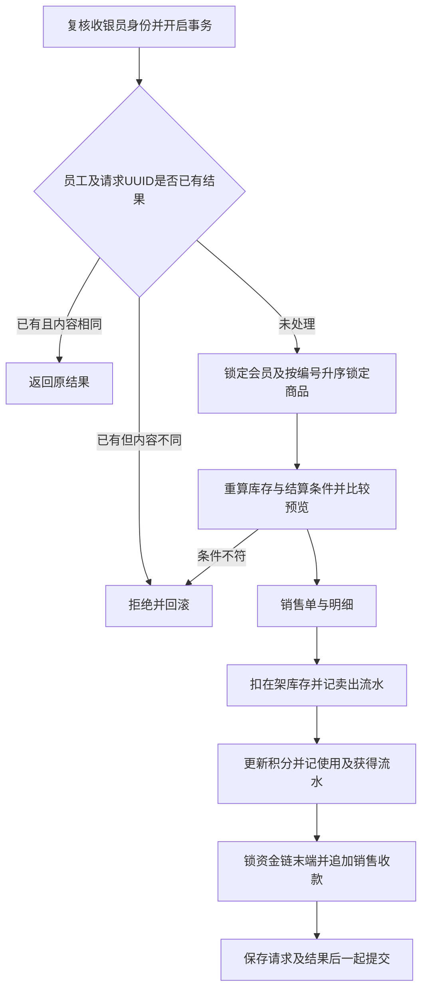

# 门店销售入口：预览、确认与事务

实现业务 B4 门店销售，并接入 B14 自动销售收款。规则以 [R-1、R-4、R-7、R-8、R-18、R-21、R-22、R-25](../specs/spec-businesses.md) 为依据。仅收银员办理，身份链沿用[入口权限方案](entry-permissions.md)。本步不实现预订取货、退款或外部支付。

## 1 页面与过程

| 页面/接口 | 数据库入口 | 行为 |
|---|---|---|
| `/sales/new`、`GET /api/sale-goods` | `api.usp_sale_catalog` | 读取结算用商品、当前价格及库存，不暴露采购价 |
| `/sales/preview`、`POST /api/sales/preview` | `api.usp_sale_quote` | 计算结算预览，不写业务数据，不预留库存 |
| `POST /sales`、`POST /api/sales` | `api.usp_sale_create` | 确认已现场收款，原子创建销售及各类流水 |
| `/sales/<单号>`、`GET /api/sales/<单号>` | `api.usp_sale_get` | 仅返回当前收银员经手的销售 |

四个公开过程逐对象授权给 `bookstore_app_cashier`。内部的 `api.usp_sale_calculate` 和 `api.usp_sale_result` 不授权给运行账号。`api`技术表和序列也不允许直接操作，通过相同所有者的静态过程访问。已有认证连接不能调用销售过程。

## 2 结算计算及确认

前端选择商品编号、整数数量、可选会员手机号及使用积分。服务层拒绝重复商品、非法类型和超限输入；数据库独立复核。技术支持范围为1至50种商品、每种1至1000件、原价总额不超过DECIMAL(10,2)上限。

`usp_sale_calculate` 供预览与创建共同调用，防止两处公式漂移：

1. 核对商品上架、定价和 `stock_total-reserved_qty >= 购买数量`。
2. 按门店日期判断会员权益，固定使用中国标准时间（UTC+8）；到期当天仍有效。未知会员拒绝，非会员留空；过期会员保留关联手机号和积分余额，本次无权益。
3. 用DECIMAL按R-7计算原价小计、先打折后抵扣、整数积分上限、实付及获得积分。负余额不能抵扣，但有效会员可获得积分。
4. 将成交单价、数量、会员档位、折扣、金额及积分结果序列化为确定顺序的JSON。

Flask用应用签名密钥对预览JSON、请求内容、UUID、当前员工和会话版本签名，放入确认表单。令牌不是数据库认证凭证；数据库信任Flask员工认证，但仍复核岗位和会话。确认不接受前端另传价格或金额，数据库会在持锁状态重算并与原预览比较；变化返回409并要求重新预览。

此令牌没有单独的到期秒数：未完成交易必须通过当前结算条件重算，已完成交易由请求记录返回原结果；账号会话版本变化后令牌不能继续使用。

## 3 一次完整事务

写过程拒绝外层事务，DAO使用`autocommit=True`调用整个过程。SQL Server过程使用`XACT_ABORT ON`和TRY/CATCH管理提交、回滚；任何中途错误都会撤销全部业务写入和请求结果。没有前端逐条写表或Flask提交一半事务的路径。

所有商品按主码升序获取`UPDLOCK,HOLDLOCK`，持续到事务结束；会员行也获取更新锁以串行核对及变更积分。库存减少不改变已订量或上架标记。每条卖出数量对应负数库存变动，操作人和时间来自受信身份及数据库时钟。

资金使用最新流水行及末端范围的更新锁，读取前额、计算后额再追加，保持销售之间的余额链连续。后续采购付款、退款、办卡及注资提现过程也必须采用兼容的锁定顺序和资金追加协议；本项不声称历史直接DML或未实现入口已经具备同样并发保护。

零积分使用或获得不生成零额积分流水。若合法极小价格与折扣舍入后实付为零，仍保留销售和库存变动，但不插入不被表约束允许的零额资金流水。序列和IDENTITY可因回滚产生空号，业务不依赖号码连续。

## 4 重复提交与留痕

新增技术表 `api.sale_request`，主码为员工手机号与请求UUID，外码指向员工和销售单。保存正规化请求SHA-256、销售ID和原始结果JSON；创建交易时一并提交。

相同员工、相同UUID和相同商品/会员/积分内容返回原结果，即使此后价格、积分或库存变化也不再执行销售。相同键用于不同内容返回409。不同UUID代表不同请求，同样内容仍可成为两笔独立销售；网络结果不确定时必须保留原确认重试。

成交行保存单价和数量，单头保存档位、折扣及金额；凭证不按当前价格重算。商品名称使用当前商品展示名，现有模型不保存成交时名称快照。收银员查询按`cashier_by`过滤，不能通过猜单号查看其他收银员的单。

## 5 验收与部署边界

完整测试48项通过，无跳过；销售部分为5项输入/签名单元测试和18项真实数据库集成测试，后者包含实际HTTP表单、重复提交、故障回滚及多连接并发。证据见[销售验收记录](../../db/results/week-7/sale-entry-20261023/README.md)。

运行副本已部署且可用，22张用户表、52个外码；没有将测试销售写入运行副本。使用说明见[应用README](../../app/README.md)。预订、取消、取货、自动过期、退货、采购、会员办理和其他管理页面继续分步实现。
