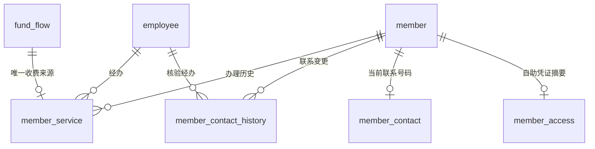

# Web 增量模型与事务设计

2026-11-02。对应 B5—B10、B13—B15；历史第六周 19 实体材料保持原样。当前应用在其上新增两个经营实体，合计 21 个；技术凭据和请求记录不计为经营实体。本文维护 Web 版已实现的数据关系、授权和事务边界。操作步骤见[全角色手册](web-operation-manual.md)，实际验收见[实施台账](../tasks/task-web-development.md)。

当前全图：[可编辑 drawio](../../ER/er-diagram-web-v1.0.drawio)、[PNG](../../ER/er-diagram-web-v1.0.png)、[本地导出源](../../ER/er-diagram-web-v1.0.html)。新图为独立增量版本，旧19实体图不修改；新增关系在drawio中可编辑，PNG保留旧图并在下方列出新增实体/技术映射和基数。

## 新增经营信息与字段

| 实体 | 主键、关系 | 保存内容与理由 |
|---|---|---|
| `member_service` 会员办理历史 | `id bigint identity`；会员、经办员工外键；`fund_flow_id` 唯一外键 | `operation` buy/upgrade；办理前后档位、到期日；实收金额及当时银/金卡费；经办人、时间。当前卡费变化不能改写历史收费，资金流水与办理记录一一对应 |
| `member_contact_history` 联系方式变更历史 | `id bigint identity`；会员、经办员工外键 | 原号码、新号码、经办人与时间。用于核对联系方式维护，不重写历史销售、积分和资金归属 |

办理历史的金额、两档费用为 `decimal(10,2)`，日期为 `date`，经办时间为 `datetime2`；金额必须大于零。首次办理的旧档位、旧到期日允许空。联系方式历史两号码均为 `varchar(11)`，经办员工为同类型外键。详细安装定义以 `db/member-entry.sql` 为准。

会员原始主键保留为稳定身份。`auth.member_contact(member_phone PK/FK, contact_phone UNIQUE, updated_by FK, updated_at)` 保存当前联系号码；未变更时以原号码作为默认联系号码。销售和续费先将当前号码解析到稳定身份，历史外键不批量改号。门店办理联系方式变更时必须现场核验归属；手机号本身不能发放自助凭证。新联系号码不得占用其他会员的稳定号码或当前联系号码。

`auth.member_access(member_phone PK/FK, token_hash binary(32), issued_by FK, issued_at)` 保存自助凭证的 SHA-256 摘要，重置后旧凭证立即失效。随机凭证通过服务器秘密和请求 UUID 的 HMAC 生成，保证未知结果重试仍返回同一凭证；秘密不写入业务表。该表及联系号码映射属于访问控制技术信息，不作为新增经营实体。

两张历史表的非主属性依赖事件主键，无独立的传递依赖。当前卡费不决定历史卡费，因此历史费用是事件快照；它们与资金金额的重复用于可审计对账。联系映射具有稳定会员标识和当前联系号码两个候选码，每个非码属性依赖候选码。完整历史 ER 的增量关系在此列出，不将旧版 19 实体图冒充当前应用全图。

## 请求与权限

运行身份为 auth/cashier/inventory/manager/guest/task 六种，连接须恰属于一种应用角色且不能为 dbo、db_owner 或 sysadmin。三个模式的表访问均拒绝，只授权固定过程。内部计算、释放和提交过程不能直接调用。

销售请求按员工和 UUID 去重，采购等写入共用 `api.operation_request`，预订创建和取消分别使用 `api.reservation_request`、`api.reservation_cancellation`。同键同内容返回已保存结果，同键异内容拒绝；新键操作已结束单据拒绝。取消请求同时绑定凭证及顾客/员工主体，重试不再次释放。过期任务只允许条件迁移有效且已到期记录，不伪造员工。

销售、取货、会员收费与退款预览由 SQL 加入十分钟 UTC 截止时间，服务端签名绑定员工及会话版本、对象、输入和原始计算快照。确认时先检查成功请求，再验证预览期限并重新计算；成功重试不因旧预览过期重复收费。采购付款、注资、提现采用原有十分钟预览合同。

## 业务细化

预订从门店创建时刻加三天精确到期；下架不取消或释放已有预订，但阻止取货，顾客可整单取消。取货一次消费本单保留数量，其他预订仍受保护；预订、释放、取货按预订行再按商品编号加锁。门店销售与预订按相同商品行锁竞争可售量。

退款允许任一收银员凭精确原销售单号核验，不能因此列出他人全部销售。按原销售明细编号顺序分配本次累计四舍五入差额，输入顺序不影响分配；总退款和回滚积分使用 R-25 累计公式。原获得积分可以回滚成负余额，原使用积分不返还。退款不增加库存，库管回收单独执行；`stock_movement(return_item_id)` 过滤唯一索引防止重复回收。零退款、零回滚保留退货数量但不写零额流水。

银卡、金卡参数一次 UPDATE 同时修改，保留跨档触发器。有效银卡差价升级保持原到期日；全价重买从有效原到期日或本次门店日期加一年，闰日落到次年三月一日。办理不清空积分。员工启停、改岗、重置口令增加会话版本；最后一个启用店长受数据库保护。

资金统一锁定末尾流水后延续余额。经营收入/支出/盈亏排除注资和提现，现金余额包含全部流水；不是会计应计利润。任务每 60 秒最多处理 100 笔，每笔独立事务；`start` 共同管理 Web 和任务，任务异常退出停止 Web 并保留 `expiry.log`，停止时回收本次子进程。

## 交付边界

- 采购草稿支持明细增删改。收银员可在成交前编辑服务端结算清单，成交后通过退款冲销。结算清单存在单进程内存，重启后丢失。多进程部署需要共享存储。
- 库存通过采购收货、销售、回收和报损改变，各笔流水保留业务来源。库存流水可按商品、原因和日期筛选。
- 库管只可删除未上架、零库存及已订量、无业务引用的商品。列表根据可删除条件显示入口，删除事务再次检查条件并清理对应子类记录。
- HTML 表单由 Flask 路由接收，另有 JSON API。事务写入经业务服务组织。部分只读路径在鉴权和输入校验后直接调用 DAO。
- 会员自助使用当前联系号码及凭证，一次返回本人历史。大量历史记录的分页仍是优化项。
