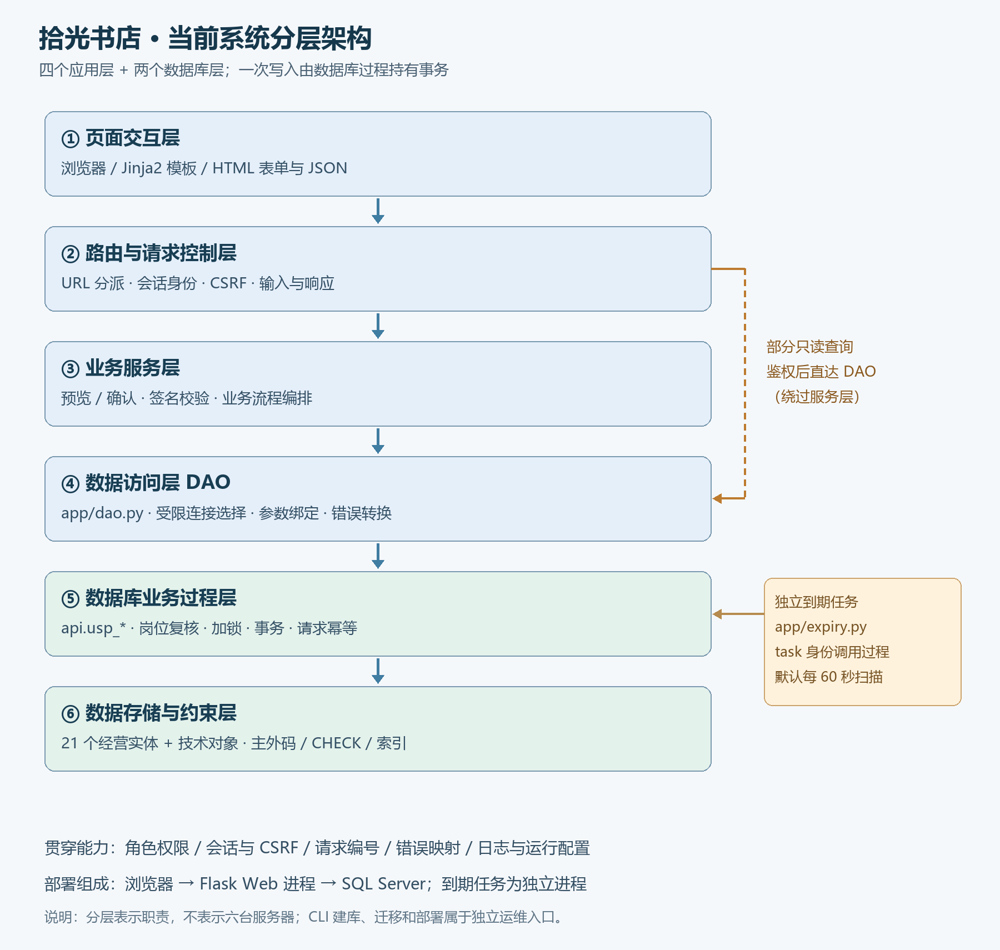

## 1 项目总体介绍

### 1.1 项目定位与当前完成范围

拾光书店是面向“单门店经营 + 线上预订到店自提”的数据库应用。系统围绕商品、会员、供应商、采购、销售、预订、退货以及库存、积分、资金流水组织数据，让顾客、收银员、库管和店长在各自权限内完成业务。第二阶段先用 ER 模型解释数据库，再通过函数依赖分析与迁移补强结构，最后把数据库能力封装成可操作的 Web 界面。

当前业务模型在第 5—6 周的 19 个历史经营实体上增加会员办理历史、联系方式变更历史，共 21 个经营实体。迁移记录、认证凭据、联系号码映射和请求去重记录属于技术对象，另行统计。前台提供商品浏览、预订和会员自助；后台提供收银结算、取货、退款、会员办理、商品与供应商维护、采购收货、报损、定价、资金管理、员工与经营报表。

| 使用者 | 主要功能 | 在业务链中的责任 |
| --- | --- | --- |
| 顾客 | 浏览商品、提交/查询/取消预订、会员凭证自助查询 | 发起需求，查看本人凭证与结果 |
| 收银员 | 销售清单、预览确认、取货、退款、会员办理 | 处理成交、收款与退款，不代替库管回收实物 |
| 库管 | 商品和报价维护、采购提交、收货、回收、报损与库存查询 | 处理实物和库存流水，不代替店长定价或付款 |
| 店长 | 定价、采购审批付款、注资提现、卡参数、员工和经营查询 | 决定经营参数与资金安排，查看全店经营情况 |

### 1.2 总体分层与架构图

按一次请求的处理职责，项目可分为六个逻辑层：页面交互层、路由与请求控制层、业务服务层、数据访问层、数据库业务过程层、数据存储与约束层。前四层组织 Web 应用，后两层运行在 SQL Server 内。它们是职责划分，部署时主要表现为浏览器、Flask Web 进程和 SQL Server，并不需要六台服务器。

图 A｜项目当前总体架构。实线表示典型写入调用链，右侧虚线表示鉴权后的部分只读请求可以直接调用 DAO。到期任务经受限身份调用数据库过程；数据库过程负责一次业务的事务，表、外码、CHECK 和索引负责数据结构与局部约束。图中各层与下表一一对应。

| 层次 | 输入、功能与输出 | 当前主要落点 |
| --- | --- | --- |
| ① 页面交互层 | 展示四类角色的页面；收集表单或 JSON 请求；展示预览、凭证、列表和可纠正错误。基础格式检查帮助用户及时修正输入 | 浏览器；`app/templates/`、`app/static/`；HTML 页面和 JSON API |
| ② 路由与请求控制层 | 按 URL 分派动作，读取可信会话身份、检查 CSRF 和请求输入，选择页面或 JSON 响应，附带请求编号 | `app/web.py`、`app/routes/` 及各功能蓝图模块 |
| ③ 业务服务层 | 组织销售、经营动作等预览与确认；验证主体、动作和签名引用；规范化输入并调用 DAO | `app/services.py`、`app/sales.py`、`app/operations.py` 等 |
| ④ 数据访问层（DAO） | 选择受限数据库连接，绑定参数，执行固定过程，转换结果和数据库错误；是请求路径唯一 SQL 出口 | `app/dao.py`、pyodbc、ODBC 驱动 |
| ⑤ 数据库业务过程层 | 再次复核岗位、状态、库存与金额；加锁、记录请求结果；将一次跨表业务放进同一事务 | `api.usp_*`；`db/*-entry.sql` 安装的业务过程与授权 |
| ⑥ 数据存储与约束层 | 保存实体、单据、历史快照和流水；用主码、外码、唯一索引、CHECK 拒绝不合法的记录 | SQL Server 业务表、认证/请求技术表、索引与约束 |

当前写路径主要遵循“路由 → 业务服务 → DAO → 存储过程 → 表”。部分只读查询在鉴权与参数检查后由路由直接调用 DAO，属于当前实现的简化。因此分层图展示的是职责与主要方向，不能据此声称所有请求都逐层经过业务服务。部署、建库和迁移 CLI 另属运维入口，其数据库操作不属于 Web 请求路径。

### 1.3 层间协作：以销售确认为例

收银员在页面选择商品后先查看预览，确认时提交 CSRF、签名引用及请求键。路由取得当前员工身份，业务服务核验预览与输入，再由 DAO 使用收银受限连接调用销售过程。过程在新事务中重新检查商品、权益和金额，写入销售单头、明细、库存、积分、资金及请求结果，成功后返回销售单号；页面跳转到凭证页。

预览期间不占用长事务，真正确认时仍需重算，防止预览之后库存、价格或配置变化。若事务中途失败，数据库回滚本次写入；若客户端重复提交，同键同内容返回原结果，同键异内容拒绝。前端禁用按钮只能改善交互，最终一致性依靠过程、事务和约束共同保证。

采购与退款采用相同分工原则，但保留业务上的不同事件：店长付款不等于库管收货，收银员退款不等于实物已经回库。资金流水、库存流水和原业务单据分别留痕，既能查询结果，也能追溯“谁在何时因哪张单改变了哪一本账”。

### 1.4 公共能力与运行组成

身份与权限贯穿页面、路由/服务和数据库：菜单按岗位展示，后端复核身份及数据范围，数据库通过 `auth`、`cashier`、`inventory`、`manager`、`guest`、`task` 六类受限连接执行固定过程。员工停用、改岗或重置口令时，会话版本变化，使旧会话失效；CSRF、请求编号、错误映射和日志由公共请求机制统一处理。

运行时除 Web 进程外，还有独立的 `app/expiry.py` 到期任务，默认每 60 秒调用到期过程；取货等入口同时即时判断到期。`run.ps1` 组织配置生成、环境检查、测试、启动、验证与停止。测试和迁移使用独立数据库副本，演示库与测试库分开；文中的历史实验结果按原验收记录引用。

### 1.5 阶段成果与阅读顺序

| 阶段 | 要解决的问题 | 主要成果 | 报告位置 |
| --- | --- | --- | --- |
| 第五周：ER 建模 | 现有表为什么这样组织，实体、标识与联系如何解释 | 19 表 ER、联系基数与参与约束、业务实例和问题清单 | §2 |
| 第六周：规范化与迁移 | 依赖是否合理，如何在保留旧事实的同时补强结构 | 逐表范式分析、冗余取舍、增量迁移、样例和回归证据 | §3 |
| 第七至九周：Web 设计与实现 | 如何把数据库能力变成四类角色可操作的业务入口 | 分层应用、权限、预览确认、事务、幂等与后台任务 | §4—§5 |
| 第七至九周：运行与验证 | 如何证明功能、异常、并发与恢复符合预期 | 页面截图、SQL 对账、测试与异常证据、局限和总结 | §6—§8 |

### 1.6 实验目标与成果证据入口

以下保留原 Web 阶段的三个实验问题，作为后续应用章节的目标：

