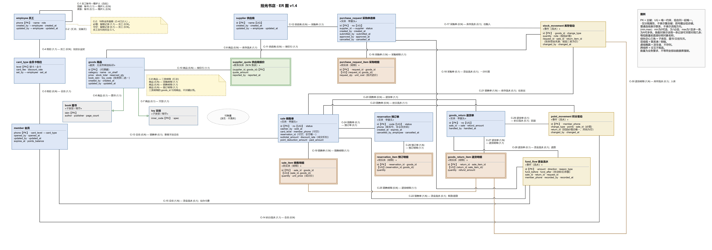

# 拾光书店实验报告：Week 5–6 详细补充

补充日期：2026-11-09 · 对应第二阶段第 5—6 周 · 与原 Web v1.0 报告合订

## 补充说明与阅读索引

本补充接续原报告全部 35 页。原报告的文字、图表、截图和页码原样保留；原 §0、§1 所写“第 5—6 周只给路径”“不在本文重复”描述的是原稿范围，本次新增内容将该范围扩展为 ER 建模、函数依赖、规范化、迁移与验证全过程。原 §2 的资料路径仍可作为详细证据入口。新增章节编号为 §8、§9，原报告既有编号不作改动。

本次内容依据仓库中已经存在的设计、SQL 脚本、原始执行输出与正式验收记录整理。表中“实际结果”均注明历史证据来源，不表示本次重新连接数据库执行；本次工作是报告补充、证据核对与 PDF 保留性检查。第六周的实现边界按当时截面描述，第 7—9 周新增能力另行对应，避免把后续完成的功能倒写成第六周成果。

| 新增章节 | 主要回答的问题 |
| --- | --- |
| §8.1—§8.3 | 为什么这样识别实体；19 张业务表各自记录什么；怎样选择标识与主要属性 |
| §8.4—§8.6 | 联系两端的基数和参与约束如何落库；三组实例怎样对应 ER 与数据库 |
| §8.7—§8.8 | v0.1 暴露了什么问题；哪些保留，哪些交给第六周迁移 |
| §9.1—§9.5 | 函数依赖、1NF—3NF、更新异常、无损连接与冗余取舍 |
| §9.6—§9.9 | 副本迁移、样例扩充、四类账对账与正反例验证 |
| §9.10—§9.12 | 缺陷修正、分阶段结论、课程要求与可复核证据索引 |

## 8 第五周：ER 建模与原设计审查

### 8.1 实验目标、输入与实施方法

第五周主题是 ch6 ER 模型。实验以第一阶段已可复现的拾光书店数据库为输入，用实体、属性、标识、联系、基数和参与约束解释已有结构，并找出业务规则与数据库实际保证之间的差距。经营范围为单门店销售、线上预订到店自提、会员、采购、库存、退货与资金管理。分析以业务规定和数据字典为准，不能依据少量样例恰好没有重复而断言一对一。

输入基线包含 19 张业务表、47 条外码和 77 行旧业务数据。工作顺序是：先逐表审查“一行代表什么、主码和候选码是什么、属性为何独立保存”；再从审查结果汇总直接联系；然后核对图例、命名和外码覆盖；最后用多商品订单、会员或散客购买、库存查询三组现成证据检验表达。该顺序使图、数据字典和 SQL 结构能够互相指认。

第五周以分析与问题登记为主，未为展示 ER 而改写旧业务结构。`docs/design/design-notes-v1.0.md` 保存反推与实例论证，`er-mapping-v1.0.md` 保存逐表、逐联系和规则落点，`issues-v0.1.md` 保存问题处置。结构修正进入第六周迁移，不把修改后的结果冒充未迁移基线。

### 8.2 实体识别、属性组织与建模决策

实体判断首先看业务身份和生命周期。员工、会员、供应商具有可独立识别的身份；采购、销售、预订、退货单具有自身编号及业务生命周期；明细依附所属单据，保存一行商品或一行原销售明细的数量和价格；报价连接供应商与商品，具有自己的金额、上报人和上报时刻；库存、积分、资金流水记录已经发生的事件。

这里的“明细为依附对象”是概念角色，不表示物理主码必须包含单头编号。本项目明细使用代理主码 `id`，并以“单头外码 + 商品外码”等唯一组合约束业务身份。`book`、`toy` 各有 ISBN 或内部编码，因此具有自身标识，同时扮演商品的子类型；不能仅因其依赖商品业务而把它们当作没有标识的弱实体。

属性按当前状态、历史快照与派生值区分。`goods` 的当前售价可改变，`sale_item.unit_price` 表示成交时的价格；当前卡档配置可改变，销售单的折扣率属于成交快照。可售量由在架量减去已订量计算，未另建可售量字段；库存、积分和资金以流水保留来源，当前计数便于读取。属性是否重复，必须先判断是否描述同一业务时点。

| 建模决策 | 选择及业务理由 | 被否方案及原因 |
| --- | --- | --- |
| 商品与子类型 | `goods` 保存通用经营属性，`book`、`toy` 保存类别专属属性 | 全塞进商品表会让图书与文创专属列大量互空，类别语义不清 |
| 单头与明细 | 单头保存一次交易，明细保存多种商品及数量、成交单价 | 在单头放“商品编号列表”无法用单值外码和逐行约束清楚表达 |
| 供应商与报价 | 档案独立，报价由供应商与商品组合定位 | 把供应商名称和建档信息复制到每条报价会引入部分依赖 |
| 会员参与销售 | 销售可以没有会员，会员外码可空 | 所有销售强制关联会员将无法表达散客购买 |
| 预订人身份 | `reservation.phone` 是联系号码，未强制引用会员 | 把预订等同会员订单会排除非会员预订 |
| 历史价格 | 明细保留成交价、采购保留批次进价 | 查询历史时联接当前价格或当前报价，会随调价改变旧交易 |

### 8.3 19 张业务表的逐表归属与标识

下表列出第五周业务基线。主码本身也是候选码；“无额外候选码”只表示没有除主码之外的最小唯一标识。可空的筛选唯一列不直接等同于全表非空候选码。其他外码和完整属性以数据字典及映射清单为准。

| 表 | 一行代表的事实与主要属性 | 主码及额外候选码 |
| --- | --- | --- |
| `employee` | 一名员工；姓名、岗位、建档与修改留痕 | 主码 `phone`；无额外候选码 |
| `card_type` | 一个卡档当前参数；费用、折扣率、设置人和时刻 | 主码 `level` |
| `goods` | 一种可经营商品；类别、名称、售价、在架量、已订量及子类引用 | 主码 `id`；无额外全表业务候选码 |
| `book` | 一条图书细节；作者、出版社、页数 | 主码 `isbn` |
| `toy` | 一条文创细节；规格 | 主码 `inner_code` |
| `supplier` | 一家供应商当前档案；名称、建档留痕 | 主码 `id`；额外候选码 `name` |
| `supplier_quote` | 某供应商对某商品的当前报价；金额、上报人和时刻 | 复合主码 `(supplier_id, goods_id)` |
| `member` | 一个会员当前档案；卡档、有效期、积分余额与留痕 | 主码 `phone` |
| `purchase_request` | 一张采购单；供应商、状态和各阶段操作者 | 主码 `id`；额外候选码 `no` |
| `purchase_request_item` | 一张采购单中的一种商品；申请数量和批次进价 | 主码 `id`；额外候选码 `(request_id, goods_id)` |
| `sale` | 一张销售单；会员可选、实付与折扣快照、收银人、状态 | 主码 `id`；额外候选码 `no` |
| `sale_item` | 一张销售单中的一种商品；数量和成交单价 | 主码 `id`；额外候选码 `(sale_id, goods_id)` |
| `reservation` | 一张预订单；联系号码、预定码、创建/到期时刻、状态 | 主码 `id`；额外候选码 `code` |
| `reservation_item` | 一张预订单中的一种商品及预订数量 | 主码 `id`；额外候选码 `(reservation_id, goods_id)` |
| `goods_return` | 一次按原销售单受理的退货；总退款与经办信息 | 主码 `id`；额外候选码 `no` |
| `goods_return_item` | 本次退货中的一条原销售明细；退货数量和分摊退款 | 主码 `id`；额外候选码 `(return_id, sale_item_id)` |
| `stock_movement` | 一次库存增减事件；商品、正负数量、事由、来源 | 主码 `id`；无额外全表候选码 |
| `point_movement` | 一次积分获得、使用或回滚；会员、点数和来源 | 主码 `id`；无额外全表候选码 |
| `fund_flow` | 一次收款或付款；金额、方向、事由、前后余额与来源 | 主码 `id`；无额外全表候选码 |

四张明细表均明确选择“同一单内同一商品只保留一行，重复件数用数量表达”；退货明细对应“同一次退货内同一原销售明细只出现一次”。这是本项目的业务取舍，并由唯一约束实现，并非所有订单系统都必须遵循的通用假设。

### 8.4 主要联系、两端基数与参与约束

下表“左→右”表示每一个左侧对象能关联多少右侧对象，“右→左”反之。`0..1` 表示可选且至多一个，`1..N` 表示至少一个。业务应有基数与当前结构实际保证分别说明。

| 左侧与右侧 | 左→右；右→左 | 外码或关联表落点 | 参与约束与实现边界 |
| --- | --- | --- | --- |
| `member` → `sale` | `0..N`；`0..1` | `sale.member_phone` 可空外码 | 会员可无消费；散客销售不必有会员 |
| `supplier` → `purchase_request` | `0..N`；`1..1` | `purchase_request.supplier_id` | 每张采购单必须指定一家供应商 |
| `supplier` ↔ `goods` | `0..N`；`0..N` | `supplier_quote` 复合主码及两侧外码 | 每个报价行必须对应一家供应商及一种商品 |
| `sale` → `sale_item` | 业务 `1..N`；`1..1` | `sale_item.sale_id` 非空外码 | 外码保证明细有单头，不能保证每个单头都有明细 |
| `purchase_request` → 明细 | 完成单据业务 `1..N`；`1..1` | `purchase_request_item.request_id` | 草稿/提交条件需要流程判断，不能仅凭外码推断 |
| `reservation` → 明细 | 业务 `1..N`；`1..1` | `reservation_item.reservation_id` | 至少一行有效明细需业务入口复核 |
| `goods` → 各商品明细 | `0..N`；`1..1` | 各明细 `goods_id` | 商品可尚未发生交易；每行明细必须引用存在的商品 |
| `reservation` ↔ `sale` | `0..1`；`0..1` | `sale.reservation_id` 可空 | 第六周筛选唯一索引补足非空预订引用的最多一次 |
| `sale` → `goods_return` | `0..N`；`1..1` | `goods_return.sale_id` | 可分次退货，每次必须按一张原销售单受理 |
| `goods_return` → 退货明细 | 业务 `1..N`；`1..1` | `goods_return_item.return_id` | 至少一条退货明细需流程控制 |
| `sale_item` → 退货明细 | `0..N`；`1..1` | `goods_return_item.sale_item_id` | 原销售行可分次退；累计数量上界需跨行校验 |
| `goods` ↔ `book` / `toy` | 每类 `0..1`；业务至多对应一商品 | `goods.book_isbn`、`goods.toy_code` | 类别 CHECK 保证引用组合；第六周筛选唯一索引补上界 |
| 员工 → 单据/流水留痕 | `0..N`；依列为必选或可选 | 各 `*_by` 外码指向 `employee.phone` | 外码保证员工存在，不能证明该岗位有权执行动作 |

商品类别决定图书与文创引用互斥；外码方向从商品指向细节，因而数据库能阻止商品引用不存在的细节，却不能单靠该外码阻止孤立细节行。销售对应预订的唯一索引也仅限制最多一次，不验证取货前状态、取货后状态或库存和资金是否同步。

### 8.5 ER 图、图例与结构覆盖核对

历史可编辑图为 `ER/er-diagram-v1.4.drawio`，对应导出图为 `ER/er-diagram-v1.4.drawio.png`。此处沿用仓库中 v1.4 成果。原 §2 的 `.png` 简写具体落在上述 `.drawio.png` 文件。图中矩形表达实体，双线矩形表达依附明细或联系实体，边端以最小/最大基数说明参与；汇总留痕连线在说明中列出所覆盖的外码。



补充图 33｜来源：既有 v1.4 ER 导出图；用途：展示商品与子类、四类单据及明细、供应商报价和三类流水的完整结构。该图包含 19 张业务表、137 个业务字段。缩印全图用于整体定位，阅读属性和联系时应结合 §8.3、§8.4 与原分辨率图片。正式验收记录记载：梁宇聪于 2026-10-22 确认 v1.4 ER 人工审查通过。本次仅引用原图，不修改既有图形文件。

第五周映射核对覆盖 19/19 张表和 47/47 条外码；联系编号沿用 C-1—C-30，其中 C-5 留空，共 29 个有效条目。联系条目数与外码数不同，是因为同类留痕外码和商品明细外码采用汇总表达。`card_type.set_by` 同时出现在汇总说明和专项设置联系中，属于同一条物理外码的两处说明，不能重复计数。

C-5 原先把当前卡参数到销售/办卡收费的“取值来源”画成联系，后因销售快照与当前参数之间没有相应外码而从历史设计中撤下。这是对“参数取值依据”和“数据库直接联系”的区分：成交折扣取自当时参数这一业务规则仍存在，但不能据此在物理关系图中虚构直接外码。

### 8.6 三组业务实例：从图到表再到结果

第一组为多商品订单。既有销售单 `S20260914-01` 包含《活着》2 件、单价 39.00，以及拾光帆布袋 1 件、单价 19.00。图上对应“销售单→销售明细→商品”，库中由 `sale_item.sale_id` 和 `goods_id` 实现。小计为 2×39.00+1×19.00=97.00；银卡折扣 0.95 后为 92.15；使用 100 积分抵扣 1.00，实付为 91.15。单头金额与明细汇总是跨表关系，行内金额 CHECK 无法单独保证。

该单的帆布袋退货指向原 `sale_item`，按既有分摊结果退回 17.85，图书行继续保留。因此退货明细必须指向原销售明细，仅关联商品无法说明退的是哪次成交、采用哪次折扣和原单分摊。

第二组为会员与散客购买。会员销售的 `member_phone` 指向会员档案，散客销售该列为空；两种单据都必须有收银员、明细和金额。第五周的旧样例不能被当作散客动作已经实现的证据，模型对散客的支持来自外码可空与业务规则，第六周扩充和后续应用测试再提供相应数据与动作证据。预订联系号码也不要求存在于会员表，取货销售是否享受会员权益需在成交时核验。

第三组为库存查询。旧四种商品在架量依次为 6、0、10、19，商品 1 已订量为 6，因此该商品可售量为 0。图中没有另造“可售库存实体”：当前计数在 `goods`，增减原因在 `stock_movement`，占用来源在有效预订与其明细。查询既要显示余额，也应能回到采购收货、销售出库、退货回收或报损来源。

| 实例要证明的事项 | 数据库对应 | 验证方式 |
| --- | --- | --- |
| 一张销售单能含多种商品 | 单头和多条 `sale_item`，每行引用一个商品 | 旧单两行与 97.00 小计复算 |
| 会员可选且保留当时权益 | 可空会员外码、销售折扣与积分快照 | 分开核对模型可表达性、实际样例和应用动作 |
| 库存可读且可追溯 | 当前在架/已订计数、库存流水、预订明细 | 计数与流水汇总、占用汇总逐商品对账 |

### 8.7 问题清单、影响与后续处理

第五周将观察到的问题分成“保留”“拟第六周调整”和有充分证据才允许的“当场已改”。本轮 ER 反推没有需要当场改结构的冲突；以下为与第六周密切相关的代表问题，其完整业务证据在 `issues-v0.1.md`。

| 问题 | 业务影响 | 第五周判断与第六周结果 |
| --- | --- | --- |
| I-04 / I-10：计数与流水汇总可能偏离 | 库存、已订和积分余额失真 | 保留快速读取结构；第六周补主动对账，完整自动维护交给应用入口 |
| I-07：多个商品可引用同一细节 | 业务一对一上界未落实 | 第六周对两种非空细节引用建立筛选唯一索引 |
| I-09：供应商改名缺修改留痕 | 不能说明最近一次修改人和时刻 | 第六周增加成对留痕列与员工外码；自动真实归属仍需受控入口 |
| I-11：单头可能没有明细 | 生成空销售或空业务单据 | 外码只能保护明细到单头引用，非空单据需提交入口控制 |
| I-16：预订可被多个销售引用 | 可能重复取货并重复收款、出库 | 第六周增加预订非空引用唯一性；未据此声称完整幂等 |
| I-17：退货归属与累计数量缺强制 | 可退错原单或累计超退 | 以主动回归检查跨行归属和数量，完整退款入口后续完成 |
| I-18：积分来源缺失或重复 | 可能重复发放、抵扣、回滚 | 第六周补来源 CHECK 和三类筛选唯一索引 |
| I-19：资金后余额可负 | 允许支出超过现有资金 | 第六周强化每行前后余额非负 CHECK |
| I-20：办卡费缺当时参数证据 | 当前费用变化后难以复核旧收费 | 第六周保留未完成边界；Web 阶段新增办理历史保存参数快照 |

### 8.8 第五周结论与交付

第五周完成了从可运行关系库到可解释 ER 模型的反推：业务主体、单据、明细、关联与事件均有对应，联系的可选性、上界和下界得到分别说明。主要收获是“图上的业务要求”与“DDL 当前能保证的事实”必须同时写清。外码、唯一约束、CHECK、主动校验和业务入口承担不同责任，不能用一张图掩盖尚未强制的规则。

交付包括可编辑 ER 源、清晰导出图、业务规则与映射、问题清单和设计验证记录。19 张业务表及 77 行旧业务事实保持为迁移前可复现基线，为第六周的函数依赖分析和副本迁移提供统一起点。

## 9 第六周：函数依赖、规范化、迁移与验证

### 9.1 实验目标与评价口径

第六周主题是 ch7 函数依赖与规范化。目标是在第五周模型的基础上，逐表检查候选码、关键函数依赖及插入/修改/删除异常，说明 1NF、2NF、3NF 的判断依据，再通过迁移和回归证明实际旧业务含义得到保留。需要拆分才提出拆分，合理结构则保留；不能为了展示拆表而破坏历史快照。

本项目的实际迁移以强化约束和补充留痕为主，版本从 v0.1 到 `v0.2-w6`。19 张业务表全部保留，新增 `schema_migration` 是迁移技术表。因此“迁移后 20 张物理表”与“19 个历史业务实体”不矛盾；后续 Web 增加两类会员历史经营实体后为 21 个经营实体，另有认证、请求等技术对象，不以物理表总数代替业务实体数。

### 9.2 函数依赖与范式判断方法

函数依赖 X→Y 表示在所有业务允许的同一关系状态中，X 相同必然要求 Y 相同；不是“这一份样例刚好相同”。候选码是最小唯一属性集合，主码也是候选码，主属性是属于任意候选码的属性。评估 2NF 时必须考虑全部候选码，不能因为有一个单列代理主码就直接跳过复合候选码的部分依赖检查。

1NF 要求每个属性保存本模型中的单值，不把多个商品编号或数量数组塞进一列。2NF 要求非主属性完全依赖每个候选码。3NF 要求每个非平凡依赖 X→A 中，X 是超码或 A 是主属性。由确定性金额公式、固定日期规则产生的依赖也要纳入判断，不能因其由 CHECK 维护就排除。

对时间语义的区分尤其关键。商品编号决定商品当前名称和当前售价，但不能单独决定跨历史交易的成交单价；同一卡档在调参前后可有不同折扣，销售单中的卡档不能决定所有历史折扣；采购批次价格也不能由供应商今天的报价反推。快照需要通过交易身份确定。

### 9.3 19 张表的依赖、候选码与范式结论

表中的“其余属性”指该行所属关系内的其他属性。结论限于设计文档明确识别的业务依赖。条件唯一性、跨表聚合与状态时序规则需另列，不能混成一个“全库已满足 3NF”的结论。

| 表与候选码 | 代表性函数依赖 | 判断及保留理由 |
| --- | --- | --- |
| `employee`：`phone` | `phone → name, role, 留痕` | 按员工档案依赖满足 3NF；岗位动作授权另验 |
| `card_type`：`level` | `level → card_fee, discount_rate, set_by, set_at` | 满足 3NF；跨档参数关系与历史快照另验 |
| `goods`：`id` | `id → category, name, 当前售价与库存计数, 子类引用` | 按当前状态依赖满足 3NF；流水汇总另验 |
| `book`：`isbn` | `isbn → author, publisher, page_count` | 满足 3NF，图书专属属性独立保存 |
| `toy`：`inner_code` | `inner_code → spec` | 满足 3NF，规格不作为身份 |
| `supplier`：`id`、`name` | `id → 档案属性`；`name → id, 其余属性` | 满足 3NF，名称唯一是本项目约定 |
| `supplier_quote`：`(supplier_id, goods_id)` | 组合码决定报价、上报人和时刻 | 满足 3NF；不存在单侧编号决定价格的规则 |
| `member`：`phone` | `phone → 当前卡档, 有效期, 积分余额, 留痕` | 按当前档案依赖满足 3NF；余额汇总另验 |
| `purchase_request`：`id`、`no` | 两个候选码分别决定供应商、状态和留痕 | 按已识别依赖满足 3NF；阶段推进另验 |
| `purchase_request_item`：`id`、`(request_id, goods_id)` | 两候选码分别决定数量和批次进价 | 满足 3NF；批次进价不能从当前报价重算 |
| `sale`：`id`、`no` | 码决定单头；`(小计, 折扣率, 积分抵扣额) → 实付额` | 严格不满足 3NF，有意保留 CHECK 维护的派生金额 |
| `sale_item`：`id`、`(sale_id, goods_id)` | 两候选码分别决定数量、成交单价 | 满足 3NF，保留成交价快照 |
| `reservation`：`id`、`code` | 码决定单头；`created_at → expires_at` | 严格不满足 3NF，固定三天派生到期时刻由 CHECK 维护 |
| `reservation_item`：`id`、`(reservation_id, goods_id)` | 两候选码分别决定预订数量 | 满足 3NF，已订量汇总另验 |
| `goods_return`：`id`、`no` | 两候选码分别决定原销售、总退款、经办信息 | 按已识别依赖满足 3NF；退款总额与明细跨表核对 |
| `goods_return_item`：`id`、`(return_id, sale_item_id)` | 两候选码分别决定数量与分摊退款 | 满足 3NF；原单归属及累计数量另验 |
| `stock_movement`：`id` | `id → 商品, 数量, 事由, 来源, 留痕` | 按完整事件关系满足 3NF；来源子集条件依赖另验 |
| `point_movement`：`id` | `id → 全行`；合法业务 `sale_id → member_phone` | 严格不满足 3NF；保留会员归属冗余，主动回归检查 |
| `fund_flow`：`id` | `reason_type → direction`；`(前余额, 方向, 金额) → 后余额` | 严格不满足 3NF；保留方向、余额快照并用 CHECK 维护 |

四张严格非 3NF 的表是 `sale`、`reservation`、`point_movement`、`fund_flow`。例如同一销售可有获得、使用和退货回滚等多笔积分，因此 `sale_id` 在积分表中不是超码；它却决定会员归属，构成必须分析的依赖。资金表中的事由决定收付方向、行内计算决定后余额，也不能因当前数据正确而忽略。

### 9.4 三类更新异常与具体业务例子

| 分析对象 | 插入异常 | 修改异常 | 删除异常与现有避免方式 |
| --- | --- | --- | --- |
| 假设“供应商档案混入报价” | 无商品报价时难以只保存供应商 | 同一供应商建档时刻重复多行，修改可能不一致 | 删除最后一条报价可能丢失供应商信息；实际以档案/报价分表避免 |
| 假设“订单头塞入商品列表” | 难以给每个商品分别设置外码、数量和价格 | 修改一行商品需重写整列内容 | 删除列表元素难追溯原销售行；实际以单头/明细分表避免 |
| 历史销售价与当前售价 | 旧交易不应依赖今天是否仍有同一售价 | 若改价覆盖历史，将改变已结账金额 | 商品停用也不应抹去原成交价；明细快照独立保留 |
| 供应商改名 | 可先建档后报价，没有必须伪造采购的要求 | 只改档案一行，其他表通过稳定编号引用 | 删除最后一条报价不会删除供应商档案；仍有引用时外码拒绝删档 |
| 有意保留的派生金额/时刻 | 新行必须同时满足计算式 | 基础值与派生值不同步会不一致 | 用明确 CHECK 拒绝矛盾值，并保留非 3NF 结论 |

“外码不允许删掉仍被引用的供应商”是引用保护，不是范式导致的删除异常；“员工岗位未校验”“库存汇总未同步”是权限或流程问题，也不能直接据此判某表不满足 3NF。实验把这些问题分开描述，避免用规范化替代业务一致性分析。

### 9.5 分解的无损连接、依赖保持与保留取舍

为说明什么时候应拆表，设计文档使用假设关系 U，而不是在项目中新增一张演示表：

```text
U(supplier_id, supplier_created_at, goods_id,
  quote_amount, reported_by, reported_at)
候选码：(supplier_id, goods_id)
依赖一：supplier_id → supplier_created_at
依赖二：(supplier_id, goods_id) → quote_amount, reported_by, reported_at
```

建档时刻只依赖组合码的一部分，因此 U 不满足 2NF。分解为 `S_demo(supplier_id, supplier_created_at)` 和 `Q(supplier_id, goods_id, quote_amount, reported_by, reported_at)` 后，交集为 `supplier_id`，且该交集决定 S_demo 全部属性，满足二元分解的无损连接条件。建档依赖在 S_demo 中维护，报价依赖在 Q 中维护，所列关键依赖得到保持。

这个论证只针对 U 表示的报价事实。真实供应商可以没有报价，不能由供应商与报价的内连接结果反建全部供应商档案。实际数据库已经独立保存供应商和报价，本轮选择保留该结构，是恒等保留，不虚构发生过拆表迁移。

对于确定性派生列，可以在理论上移去实付额或到期时刻，再由基础属性重算；但本轮为保持现有查询、业务快照和对账口径而保留，并用 CHECK 约束计算一致。积分会员归属可通过非空销售外码与销售表连接恢复，当前仍保留便于按会员查询；第六周对归属不一致依赖主动回归发现。保留冗余的代价、约束责任与严格非 3NF 结论均明确登记。

### 9.6 迁移前保护、实施顺序与结构变更

迁移先对来源库进行 COPY_ONLY 备份、校验及还原，再在独立新副本操作。正式验收记录的来源库为 `ShiguangBookstoreWeek3`，工作库为 `ShiguangBookstoreWeek6Final20261021220913`，另有后缀 Failure 的故障副本。库名和环境是历史执行事实，本次补稿未创建数据库或运行迁移。

执行前核对 19 张表、47 条外码、77 行旧业务事实，保存完整旧列快照和关键查询输出。`migration.sql` 要求调用者传入 DatabaseName，只允许 `ShiguangBookstoreWeek6` 前缀的专用副本；原始库或错误目标由 51040 拒绝，避免误写。成功迁移有版本标记，重复执行输出 SKIP；未完成迁移的残留状态需恢复新副本，不能盲目续跑。

| 迁移项目 | 实际结构调整 | 为什么需要及如何保留旧事实 |
| --- | --- | --- |
| 迁移元数据 | 新建 `schema_migration`，记录版本、时间、执行者和状态 | 区分是否完整执行；不作为新增经营实体 |
| 供应商留痕 | 新增 `updated_by`、`updated_at`；成对 CHECK 和员工外码 | 旧记录均留 NULL，不用建档信息虚构最近修改史 |
| 子类引用上界 | `UX_goods_book_isbn`、`UX_goods_toy_code` | 只对非空值唯一，允许其他类别存在多个 NULL |
| 预订取货上界 | `UX_sale_reservation_id` | 一个非空预订引用至多对应一张销售，直销 NULL 仍可多行 |
| 积分事件上界 | `UX_point_movement_earn/use/return` | 按类别分别限制原销售或退货来源，不能混用一条普通唯一约束 |
| 积分来源形态 | 替换 `CK_point_movement_kind` | 三类均要求原销售来源；只有退货回滚要求退货来源 |
| 资金非负 | 强化 `CK_fund_flow_amount` | 金额为正，前后余额非负；历史补录也必须满足 |

迁移前先检测重复细节引用、重复预订销售、积分来源缺失、三类重复事件和负资金等冲突；存在冲突即停止，不能通过删除旧行让约束“通过”。DDL 与版本标记处在同一事务中，失败整体回滚。迁移完成后为 20 张物理表、49 条外码、77 行旧业务数据和 1 条迁移记录；旧业务表不删除、不重命名、不覆盖。

以下为仓库已有统一验收入口的复现示例，需在具有备份、还原和建库权限的实验实例使用。入口自行创建新副本，目标库或证据目录存在即拒绝覆盖：

```powershell
pwsh -File db/accept-week-6.ps1 `
  -Server 'localhost' `
  -SourceDatabaseName 'ShiguangBookstoreWeek3' `
  -DatabaseName 'ShiguangBookstoreWeek6ReportReplay20261109' `
  -EvidenceDirectory 'db/results/week-6/report-replay-20261109'

# 只读核对既有正式证据，不连接数据库：
python db/checks/audit-week-6-artifacts.py
```

### 9.7 样例扩充、固定时点与迁移前后对账

`sample-data-week-6.sql` 增加 W6-S01—W6-S11 场景，使用新商品编码、会员标识和单据编号，不更新、不删除旧业务行。覆盖不同商品、会员与散客销售、采购阶段、预订状态、分次退货、供应商报价和三类流水。静态终态只能证明数据可表达该场景，不能替代提交、取消、自动过期等动作测试。

| 对象/指标 | 迁移前或旧截面 | 样例扩充后的固定合法截面 |
| --- | --- | --- |
| 业务表与物理表 | 19 业务表、19 物理表 | 19 业务表、20 物理表（含迁移表） |
| 业务总行数 | 77 | 198；另有 1 行迁移元数据 |
| 商品 / 会员 | 旧对象完整保留 | 10 / 6 |
| 采购 / 预订 / 销售 / 退货单头 | 旧单据及来源完整保留 | 10 / 8 / 9 / 5 |
| 库存 / 积分 / 资金流水 | 旧事件完整保留 | 31 / 13 / 29 |
| 现金余额 | 1430.30 | 555.30 |
| 经营盈亏 | -69.70 | -944.70 |

纯迁移阶段的新旧列快照和关键查询应一致；样例扩充后新交易改变全库余额，不能再要求新余额等于旧余额。旧截面按 2026-09-20 固定时点另行核对，新场景按各脚本指定时点核对。经营盈亏排除注资/提现，现金余额包括全部收付；两者含义不同，不能混用。

库存查询专项使用固定时刻 2026-09-29 18:00:00。实际原始输出为 10 种商品、31 条库存流水、汇总不一致项 0；在架总量 73、状态口径已订总量 9、可售总量 64。商品《活着》在架 6、已订 6、可售 0，但该占用对应已到期未释放的预订。专项输出明确标记 `AUTO_EXPIRY_NOT_APPLIED`，说明“计数与当前状态对得上”不代表自动过期已实现。

另一个自动过期边界脚本按自身固定时刻记录 2 张已到期仍有效预订；该数量与库存专项固定截面观察到 1 张到期记录使用不同查询时点，应分别引用，不能合并为同一次测量。

销售统计专项可复核《SQL Server 实战》售出 6、退回 2、净销量 4，成交毛额 426.00；拾光保温杯售出 4、退回 2、净销量 2，成交毛额 144.00。毛额来自数量×成交价，实收还受折扣和积分影响；退款按退款发生日期记入逐日净收款，不将销售当日与退款当日混合。

### 9.8 四类账的一致性与校验责任

| 账目 | 应满足的不变量 | 第六周验证与不能推导的结论 |
| --- | --- | --- |
| 库存账 | 每商品在架量 = 该商品库存流水带符号数量之和 | 固定合法截面对账一致；不保证任意直接 UPDATE 自动同步 |
| 预订占用账 | 已订量 = 按既定有效状态口径汇总的预订明细数量；可售=在架-已订 | 另列时间已到期但状态未处理的占用，不能混称自动释放 |
| 积分账 | 当前余额 = 积分流水累计；获得、使用、回滚有正确销售来源 | 来源 CHECK、类别唯一性和归属回归互补；汇总相等仍可能有错额事件 |
| 资金账 | 每行后余额符合收付公式；相邻前后余额衔接；来源单据金额相符 | 行内 CHECK 保护公式和非负，跨行连续与原单金额通过主动回归检查 |

退款、积分回滚与回收还需核对原销售归属、累计退货不超过原数量、退款总额等于明细分摊、正额退款有且仅有对应资金流水、零额退款不写零金额流水。退款并不必然等于立即回库；库存实物恢复需要对应回收事件。第六周主要验证合法截面和已经实现的约束，完整跨表原子入口在后续应用阶段补齐。

跨表不一致的 NULL 判断必须显式处理。若只用 `p.sale_id <> r.sale_id`，当 `p.sale_id` 为 NULL 时结果为 UNKNOWN，可能漏检；应组合 `IS NULL` 与不等判断。当前第六周回归补足此类来源检查，不能因为两侧都是外码就认为归属自然正确。

### 9.9 回归、反例、权限与故障恢复证据

正式主代理验收采用 00—44 共 45 步历史输出，范围见 `docs/reviews/review-week-6.md`，原始文件在 `db/results/week-6/acceptance/final-check/`。本节以该轮为主要来源，早期用户反馈和 acceptance-b 的独立重跑保留各自归属，不拼成一轮新结果。

| 验证类别 | 方法与预期 | 正式记录中的实际结果 |
| --- | --- | --- |
| 来源与还原 | 完整旧列快照一致 | 六组快照比较，每组覆盖 19 张表，均一致 |
| 迁移语义 | 不仅比较行数，还比较内容和关键查询 | 步骤 06 与 11 查询逐字节相同，77 行旧业务事实保留 |
| 结构反例 | 22 项已实现 DDL 规则应拒绝非法数据 | 步骤 16 的 22 项均符合预期，测试回滚 |
| 权限正反例 | 合法岗位操作允许；三类越权应为权限错误 | 步骤 17 三次越权均为 SQL Server 229 |
| 中途失败事务 | 先插合法销售与明细，再插数量 0 的明细 | 步骤 18 触发 547，整笔回滚，临时单头/明细无残留 |
| 唯一索引细节 | 重复非空值拒绝，合法多个 NULL 可共存 | 步骤 21 两个商品索引对应 NULL 均为 5 行 |
| 历史快照 | 临时调当前价格不能改旧成交事实 | 步骤 19 调价快照专项通过并恢复 |
| 供应商留痕 | 单侧留痕拒绝；合法成对填写允许 | 步骤 20 专项符合预期并回滚 |
| 日期规则 | 5 个有效性示例及 6 个首次/重买/闰日示例 | 步骤 25 共 11 个固定输入规则示例匹配 |
| 重跑安全 | 迁移和样例再次执行不产生重复事实 | 步骤 12、28 输出 SKIP |
| DDL 故障恢复 | 注入同名索引冲突，中途错误不能留半迁移 | 步骤 34 错误 1913；35—36 确认 DDL 与旧事实回滚 |
| 原库目标保护 | 尝试以原始库为迁移目标必须失败 | 步骤 40 错误 51040，原库快照保持 |

结构反例涵盖主码或业务键重复、父子组合重复、不存在的外码、非空要求、非法数量、来源组合与负余额等，预期是被已存在的 DDL 拒绝。尚未实现的流程规则不混入“22 项约束均通过”来扩大结论。

测试判据本身也做了反向验证：非权限错误不能被当作越权拒绝成功，注入多余授权后权限检查必须发现。正式步骤 37、42 分别命中 51039 与 51030，随后撤销注入权限。日期变异将到期当天错误排除或采用错误闰日规则时，分别得到 51966、51967。这些预期失败证明测试能识别错误，不表示业务运行故障。

备份记录包含 COPY_ONLY、BACKUP CHECKSUM 与 RESTORE VERIFYONLY CHECKSUM 成功；正式记录同时说明没有取得操作系统备份文件长度或 SHA-256。本报告沿用证据实际范围，不把 SQL 备份校验写成已获得文件哈希。

### 9.10 实验中的问题、修正与复核

| 现象 | 原因与修正 | 复核意义 |
| --- | --- | --- |
| 新增 `updated_by/updated_at` 后同批次报列名无效 | 静态编译时新列尚不可见；依赖新列的约束与检查使用动态 SQL 批次 | 迁移可从未改动副本执行，而非依赖手工先加列 |
| SQLCMD 变量未替换或库不存在 | 调用者显式传 DatabaseName，不在脚本内覆盖变量；执行前检查目标 | 迁移目标清楚，原始库保护能实际触发 |
| 无迁移元数据时回归停止 | 是前置状态检查生效；先正确迁移，再回归 | 不跳过缺失结构掩盖执行顺序错误 |
| 重复回滚积分反例未触发唯一性 | 最初选择无既有回滚的散客退货；改为复制已有会员退货回滚来源 | 真正命中目标索引，避免准备数据不足导致假结论 |
| 初稿把四表判断为 3NF | 忽略确定性派生列或会员归属依赖；已纠正严格范式结论 | 保留冗余可有业务理由，但必须准确说明理论代价 |
| 固定日期示例被误读为应用动作完成 | 分开列固定输入规则、静态会员记录及实际业务入口 | 公式通过不等于收费、续费、权益恢复已执行 |

复核不仅看最终 PASS，还检查是否触发预期对象、错误码是否正确、事务是否回滚、前后完整快照是否一致。采用新隔离副本重新执行实际迁移，不能仅靠已经迁移过的副本返回 SKIP 证明迁移过程可靠。

### 9.11 第六周边界与向 Web 阶段的衔接

| 第六周确认的结果或边界 | 第 7—9 周对应实现 | 本报告的结论边界 |
| --- | --- | --- |
| 有限来源唯一性已强化，尚无通用请求幂等 | 请求键、内容摘要与成功结果同事务保存 | 筛选唯一索引不能代替跨动作重试语义 |
| 到期记录仍可能保持有效，未自动释放 | 独立 expiry 任务与入口即时到期判断 | 第六周观察脚本成功不等于自动过期功能成功 |
| 余额/计数依赖写入约定和主动回归 | 销售、取货、退款、采购等受控事务入口 | 第六周合法快照不证明任意直接 DML 都安全 |
| 未完成并发库存竞争控制 | 商品锁、确认时重算与真实并发测试 | 事务回滚单例不等于所有并发场景通过 |
| 供应商留痕列已补齐但可手动伪填 | 库管受控修改入口与岗位复核 | 外码只证明员工存在，不能证明真实操作者 |
| 办卡费历史参数与动作证据不足 | 新增 `member_service` 保存办理前后档位、历史费率及资金来源 | 两张新增经营历史实体属于 Web 增量，不改写旧 ER 基线 |

第六周由 19 张业务表出发完成依赖分析和增量迁移，实际没有大规模拆表。实验结果证明本轮旧数据、已实现结构约束与固定合法截面符合预期，并通过故障注入证明所测迁移事务能够恢复。完整业务入口、通用幂等、自动过期和更广并发验证属于后续阶段，已在原报告 §3—§6 展开。

### 9.12 课程要求、交付物与原始证据索引

下表把分析、实现和验证串联起来。证据路径均相对项目根目录；验收目录中的历史输出保留原执行日期与归属。本次补稿未将文档复核记成新的数据库验收。

| 课程要求 | 本补充位置 | 设计/实现文件与证据 |
| --- | --- | --- |
| 实体、属性、主码和候选码 | §8.2—§8.3 | `docs/design/er-mapping-v1.0.md`；`docs/specs/spec-data-dictionary.md` |
| 联系、基数和参与约束 | §8.4—§8.5 | `ER/er-diagram-v1.4.drawio`；`ER/er-diagram-v1.4.drawio.png` |
| 多商品、会员/散客、库存实例 | §8.6 | `docs/design/design-notes-v1.0.md`；`db/results/week-4/week-4-verify2-query.txt` |
| 原设计问题及保留理由 | §8.7—§8.8 | `docs/design/issues-v0.1.md` |
| 逐表依赖、异常与范式 | §9.2—§9.4 | `docs/design/design-normalization-v1.0.md`，含逐表分析和 §25 索引 |
| 无损连接与依赖保持 | §9.5 | 同设计文档 §4、§25.1；区分假设分解与实际恒等保留 |
| 迁移六要件与旧表保留 | §9.6 | `db/migration.sql`；`db/checks/migration-check.sql` |
| 旧语义与新样例核对 | §9.7—§9.8 | `db/sample-data-week-6.sql`；`db/regression.sql`；正式步骤 05—15、29—30 |
| 非法数据与越权拒绝 | §9.9 | `db/tests/regression-negative.sql`；`db/role.sql`；正式步骤 16—17 |
| 事务、故障和恢复 | §9.9—§9.10 | `db/tests/transaction-week-6.sql`；正式步骤 18、31—36 |
| 销售、库存、报价/成本、日期专项 | §9.7、§9.9 | `db/tests/*-week-6.sql`；正式步骤 19—25 |
| 验收结论和执行归属 | §9.9—§9.11 | `docs/reviews/review-week-6.md`；`db/results/week-6/acceptance/final-check/` |
| 原始产物只读复核 | §9.6、§9.12 | `db/checks/audit-week-6-artifacts.py`；验收 JSON、原始 txt 与快照 |

第五周解决“结构怎样解释、哪些规则还没有落地”，第六周解决“依赖是否合理、怎样保留事实并可靠迁移”。两周共同为后续 Web 开发建立了可解释、可对照、可恢复的数据库基线。原报告中的页面、事务与测试章节由此获得明确的设计来源；本次新增内容与原 35 页合订，形成第二阶段从模型到应用的连续实验记录。
