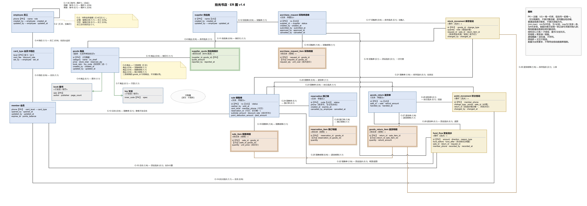
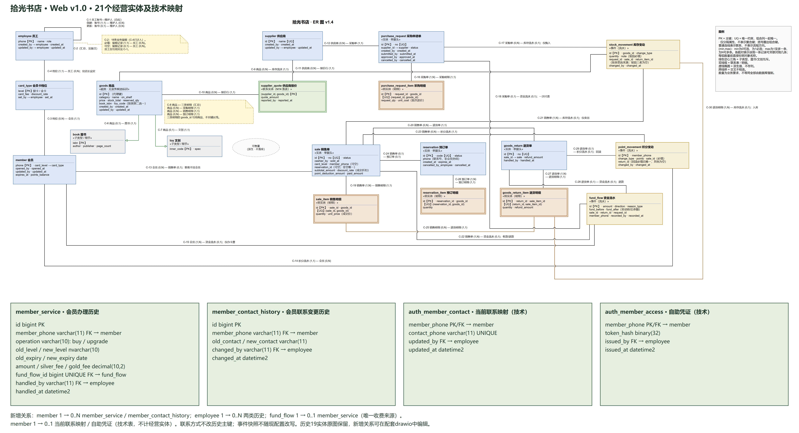
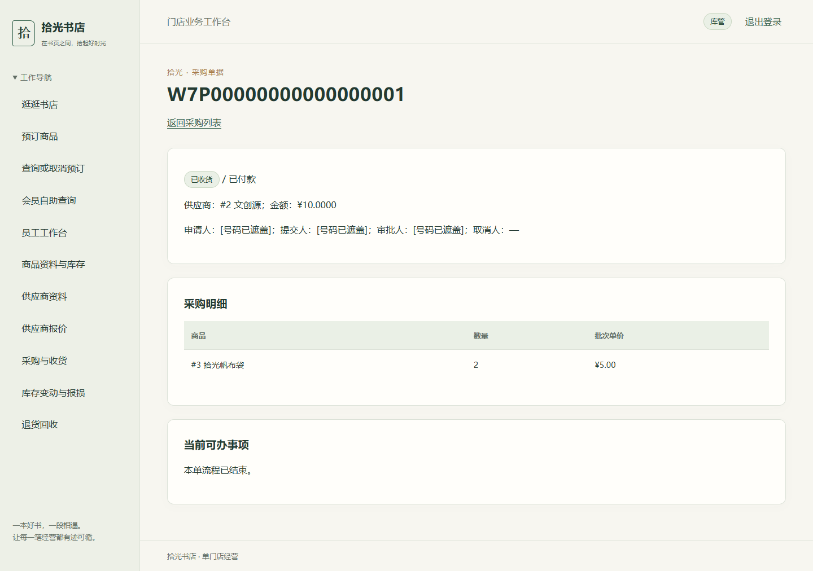
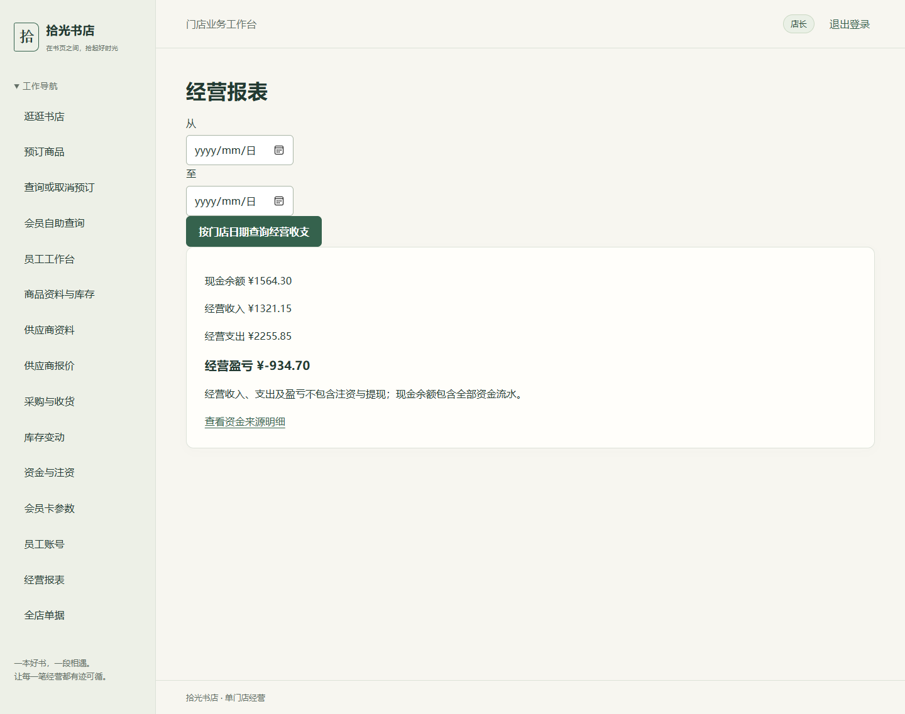
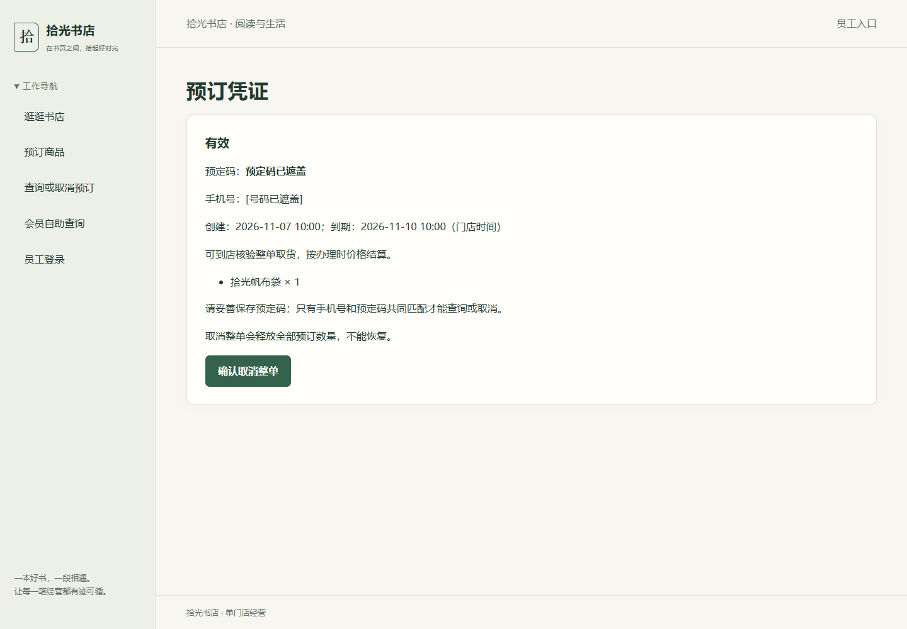
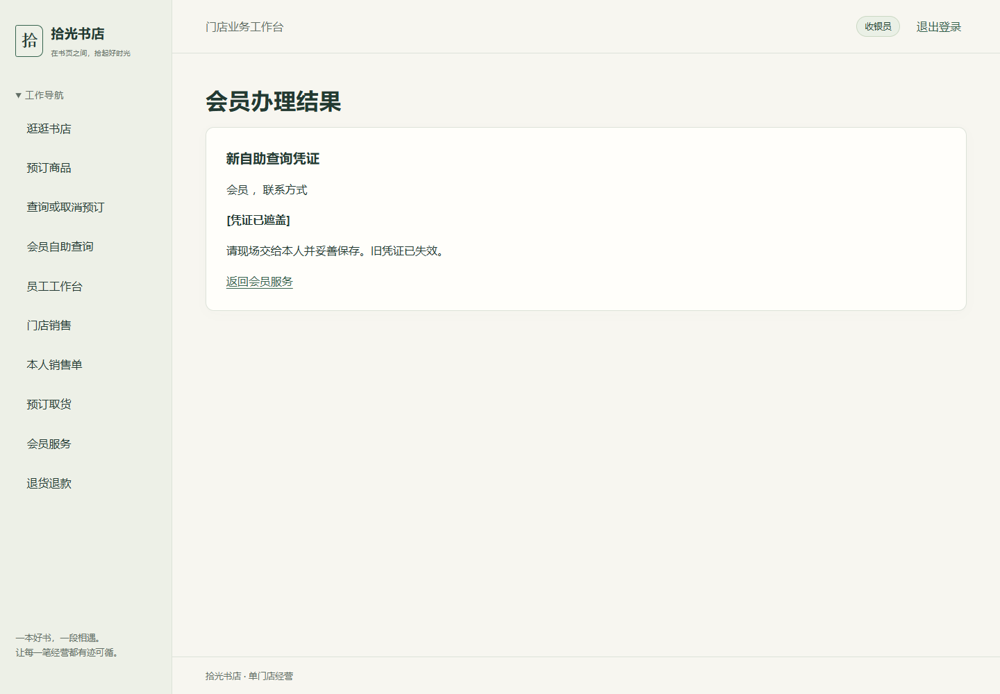
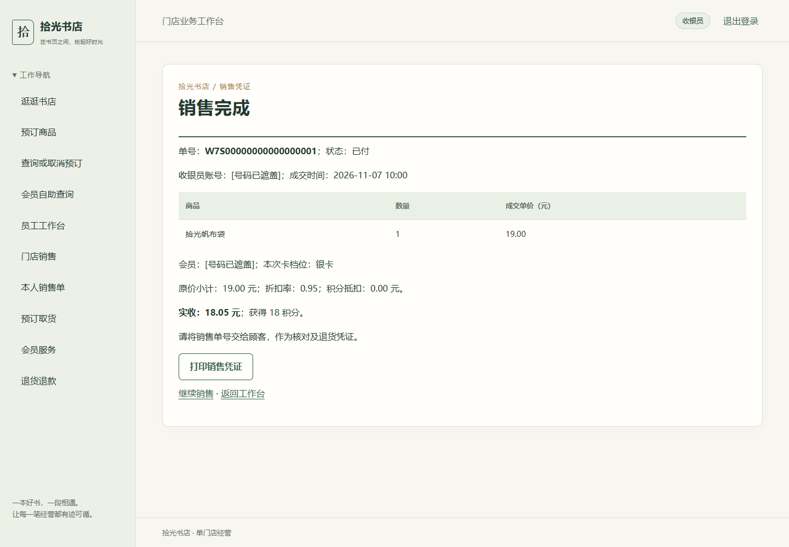
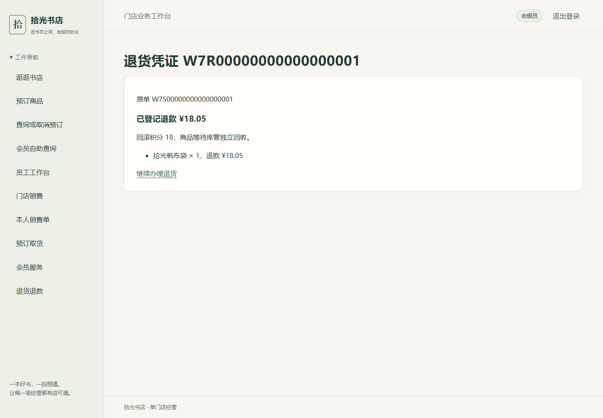
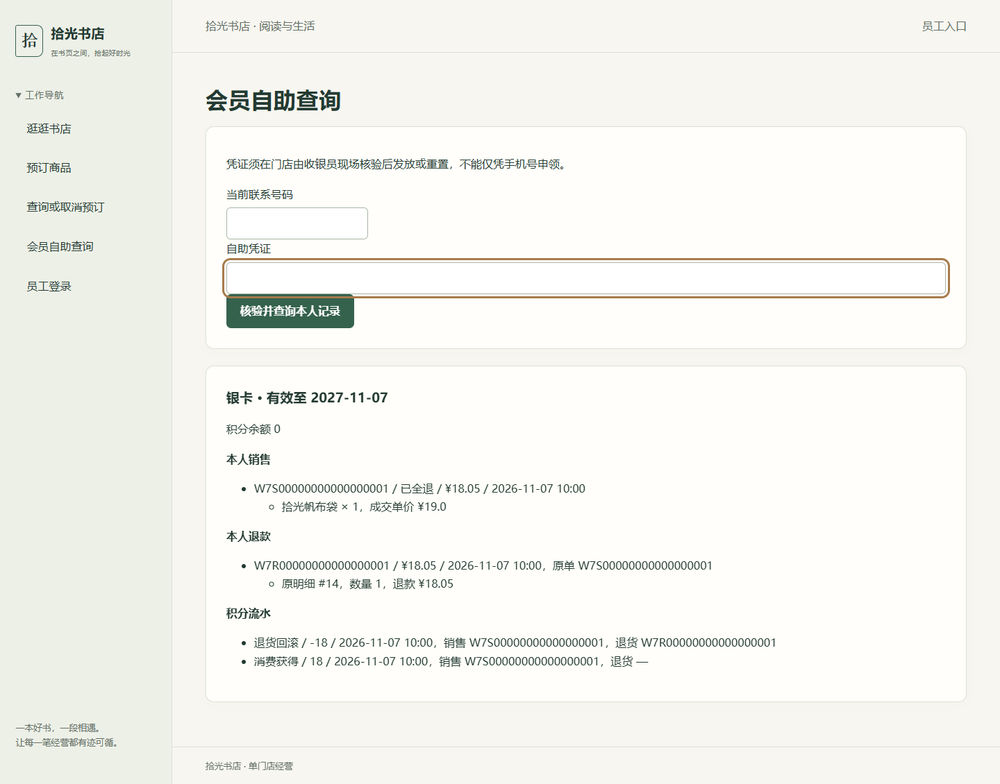
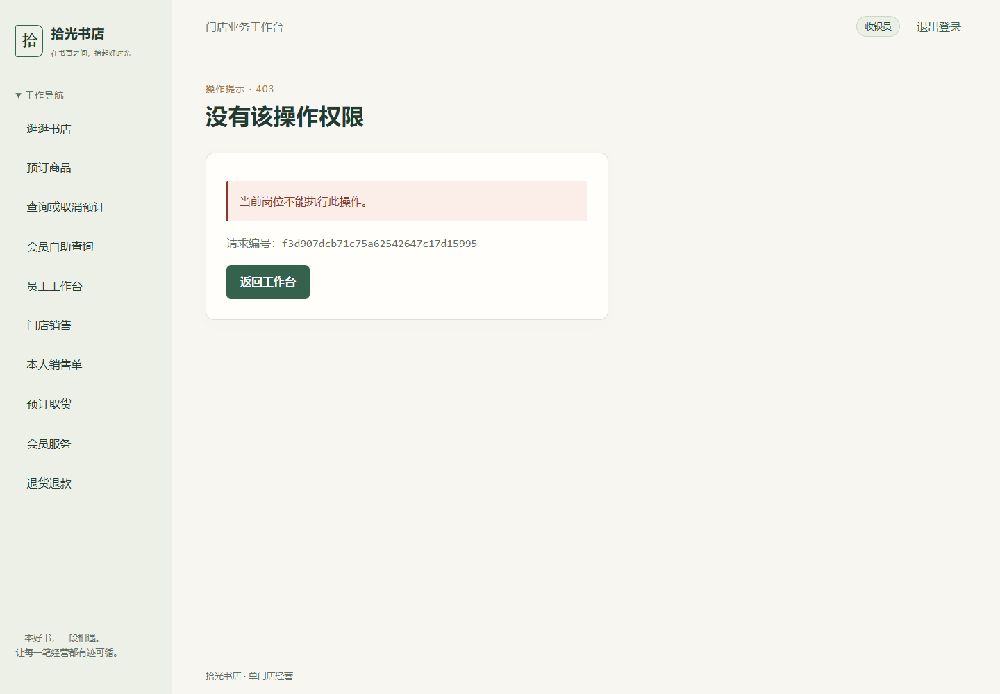

# 拾光书店数据库实验报告

第二阶段 · 第 5—9 周 · Web v1.0 · 2026-11-07

## 1 实验目标

拾光书店需要处理商品档案、采购、预订、销售、会员和退货。第一阶段已有可运行的 SQL Server 数据库，但要把它交给顾客和店员使用，还需回答三个问题。已有表如何表达订单、会员和库存之间的联系？调整数据库后，原有订单金额与库存结果能否保持一致？不同角色通过页面操作时，系统能否同时保证权限正确和数据完整？

我们在第 5 周从已有表和业务规则反推 ER，找出结构与约束缺口。第 6 周逐表分析函数依赖，确定保留与调整方案，在备份副本上完成迁移并比较迁移前后的数据。第 7—9 周将这些规则落实到四角色 Web 界面，通过浏览器、应用测试和真实 SQL Server 回归验证操作结果。

## 2 数据库设计与取舍

### 2.1 从业务事实确定实体和联系

我们先确定每一行代表什么，再确定它如何被标识、能引用哪些对象。一笔销售有一张单头和多条明细。单头记录销售单号、经办人、会员权益与实收，明细记录商品、购买数量和当时的成交单价。每条明细都必须引用一张销售单和一个商品。同一笔销售的同种商品合并成一行，由 `(sale_id, goods_id)` 的唯一性约束保证。采购、预订和退货也采用单头与明细结构。

商品采用超类和子类结构。`goods` 保存名称、类别、售价、库存和已订量，图书的 ISBN 与文创的内部编码分别对应子类档案。销售明细只引用统一商品编号，因此同一订单可以同时包含图书和文创。会员关联可为空，所以散客也可下单。已有成交价与折扣保存在单据中，之后调价或调整会员权益时仍能核对原金额。

图 1 展示第 5 周设计经后续审查形成的 19 个经营实体。销售单通过明细连接商品，库存流水通过来源外码连接采购、销售或退货明细。商品上的在架量和已订量用于快速查询，来源流水用于解释这些值怎样变化。

### 2.2 函数依赖、更新异常与规范化

函数依赖依据业务规则和候选码确定。以供应商报价为例，供应商 1 给商品 1 报价 ¥22.00，给商品 2 报价 ¥26.50。供应商 3 给商品 1 报价 ¥24.00。单独给出供应商或商品均无法确定报价。每家供应商对每种商品只有一条当前报价，因此使用以下依赖和约束。

~~~text
supplier.id → name, created_by, created_at, updated_by, updated_at
(supplier_id, goods_id) → quote_amount, reported_by, reported_at
(sale_id, goods_id) → quantity, unit_price
~~~

报价表每个字段为单值，符合 1NF。金额、上报人、上报时间依赖整个复合码，符合 2NF。识别出的决定项为候选码，符合 3NF。现有供应商档案与报价已分表，我们保留这个结构。如果把供应商名称放进每一条报价，新增供应商就会被迫同时录入报价，改名需要修改多行，删除最后一条报价还可能丢失档案。分表后只在档案表改名，通过 `supplier_id` 连接就能查出每条报价的供应商。采购明细保存批次进价，当前报价从 ¥22.00 变为其他价格时，已确认采购仍保留原进价。

| 原有结构或规则 | 可能产生的问题 | 本阶段的决定 |
| --- | --- | --- |
| 供应商记录只保留建档信息 | 后续改名或维护时，无法辨认最近修改人和时间 | 保留供应商表，新增成对的修改人和修改时间。旧记录无可靠留痕时两列均为空 |
| 商品子类编码、销售的预订来源和积分来源存在条件唯一要求 | 重复商品档案、一次预订对应多笔销售或同一来源重复记积分 | 对有值的子类编码、预订来源以及指定类型的积分来源建立筛选唯一索引 |
| 商品同时保存库存与已订量，并通过流水记录来源 | 分别修改库存、预订和流水会让可售量与业务事实不一致 | 保留查询用计数，通过业务事务同步更新，回归时按来源及有效预订重新对账 |
| 单头与明细已拆分 | 合并会重复经办人、状态等单头字段，多行更新容易出现冲突 | 保留拆分，依靠主外码还原一单多行，明细继续保存价格快照 |

有四张表保留了严格 3NF 下的冗余。预订的创建时刻决定三天后的到期时刻。销售的原价小计、折扣率和积分抵扣共同决定实付金额。合法积分流水中的销售单决定会员归属。资金流水的前余额、方向和金额决定后余额。我们保留这些值用于读取到期队列、展示成交凭证、查询积分及复核资金链。预订到期、实付金额和资金余额公式由 `CHECK` 校验。积分归属通过交易入口与主动回归核对。

第 6 周迁移保留原 19 张业务表和原有字段、码及联系。新增字段与约束没有把原有依赖拆到不同关系中，旧列可直接投影还原。订单头与明细、供应商与报价继续通过主外码连接。第 7—9 周新增 `member_service` 和 `member_contact_history`，分别记录多次办理和联系变更。会员标识保持稳定，原销售与退款记录无需因换号改写。身份凭据、请求去重及迁移版本属于技术记录。Web 版因此有 21 个经营实体。

图 2 保留商品、单据和流水的原关系，并在会员一侧增加办理及联系变更历史。当前会员档案服务于资格判断，历史表说明资格和联系方式如何演变。

## 3 迁移与回归实验

1. **保存原始截面。** 对 v0.1 做带校验的备份并还原工作库。迁移前读取 19 张业务表的旧列快照和关键查询。当时共有 47 个外码、77 行旧业务数据。先比较源库与还原副本，确认副本可作为迁移基线。
2. **检查并调整结构。** `migration.sql` 在写入前检查重复业务键和非法流水。事务内新增 `schema_migration`、供应商修改留痕、两个员工引用外码和六个筛选唯一索引，并强化积分来源及资金金额约束。旧供应商留痕保持 `NULL`。成功时提交版本记录，重复运行时通过版本记录识别已迁移状态。
3. **先比较旧事实，再装载新样例。** 迁移后以相同查询核对销售明细、商品销量、库存占用与旧资金截面，并比较 19 张业务表旧列的行数与 SHA-256。确认旧事实一致后，由 `sample-data-week-6.sql` 加入会员、采购、预订和退货场景，再用 `regression.sql` 检查扩充截面。
4. **验证失败时能撤销。** 在另一还原副本预建一个与迁移目标同名的索引，制造 SQL Server 错误 1913。失败后核对该副本仍为 19 张用户表、47 个外码，迁移版本表和新增供应商列均未留下，旧列快照一致。结构反例与权限拒绝也在隔离环境运行。

| 同一批旧数据的查询 | 迁移前 | 迁移后 |
| --- | --- | --- |
| `S20260914-01` 中《活着》的明细 | 2 本 × ¥39.00，行金额 ¥78.00 | 2 本 × ¥39.00，行金额 ¥78.00 |
| 《活着》的旧样例销量和毛销售额 | 5 本、¥195.00 | 5 本、¥195.00 |
| 《活着》的库存与占用 | 在架 6、已订 6、可售 0 | 在架 6、已订 6、可售 0 |
| 旧资金截面 | 现金 ¥1,430.30、经营盈亏 −¥69.70 | 现金 ¥1,430.30、经营盈亏 −¥69.70 |

迁移后第六周固定截面为 **20 张用户表、49 个外码**，其中 19 张为业务表，1 张为迁移技术表。新样例装载后，扩充截面的现金为 ¥555.30，经营盈亏为 −¥944.70。这个金额变化来自新增业务样例，旧数据的迁移前后查询仍一致。两轮第六周验收各记录 45 个步骤，其中 22 个结构反例按预期被拒绝。

## 4 Web 实现与角色操作

### 4.1 应用如何组织

Flask 接收请求，Jinja 渲染页面。页面主要通过 HTML 表单提交，也提供 JSON API。路由读取输入与会话，业务服务组织需要预览和确认的写入。DAO 负责参数绑定、连接和结果读取，SQL Server 存储过程执行最终的权限和事务检查。

| 例子 | 从输入到结果 |
| --- | --- |
| 查询本人销售单 | 收银员访问 `GET /sales`。路由验证会话和岗位，读取分页参数，直接调用 `EmployeeDAO.sale_list`。DAO 将当前员工和分页值绑定给 `api.usp_sale_list`，返回该员工的销售单供页面显示 |
| 创建门店销售 | 收银员选择商品、数量和会员选项，先预览应收。确认时 `SalesService.create` 验证签名凭据，DAO 调用 `api.usp_sale_create`，最终由 `api.usp_sale_commit` 在事务内复核可售量、权益和金额，写单头、明细、库存、积分与资金流水，再返回单号 |

预览和确认分开，方便收银员先核对价格及折扣，也给数据库机会在确认时检查库存或权益是否已变化。订单写入和库存扣减在同一事务中完成，任何一步失败都回滚。同一请求键及相同内容重试可取回原结果，防止重复结算。

系统按岗位显示菜单，并在后端独立鉴权。数据库使用 `auth`、`cashier`、`inventory`、`manager`、`guest`、`task` 六种受限连接。前四类服务员工认证与岗位操作，`guest` 用于公开与顾客流程，`task` 用于到期处理。关键过程还会检查当前岗位和相应数据范围。

### 4.2 四角色流程与权限

| 角色 | 输入和操作 | 结果与权限 |
| --- | --- | --- |
| 顾客 | 查看在售商品，选商品和数量后提交预订，凭手机号和预定码查询、取消或到店核验。会员还可用开卡时取得的凭证自助查询 | 创建预订后保留可售量，取消或到期时释放。顾客只可访问公开资料和凭证对应的记录 |
| 收银员 | 员工登录后新建销售清单，增删改行，或输入预订凭证取货。预览后确认收款，也可办卡、查本人单据、凭原销售单发起退款 | 产生销售、会员办理或退款凭证。无法进入店长定价与经营管理 |
| 库管 | 新建商品和供应商档案、维护报价，填写采购草稿和明细。提交后等待店长付款，再确认收货。也可登记报损与回收退货 | 负责实物库存和流水。只能删除零库存、未上架且无引用的商品档案 |
| 店长 | 设置售价和上架状态，审批采购并付款。查看经营、资金和全店单据，维护员工与卡参数 | 付款写资金流水。实物收货由库管办理，形成独立库存记录 |

**从采购到入库。** 店长先在演示库注资 ¥1,000.00。库管创建采购草稿，录入商品 3（拾光帆布袋）2 件，批次进价 ¥5.00。库管提交后由店长审批并确认采购付款。库管整单收货，单据显示「已收货」。数据库在该采购单下记录入库 2 件。资金在付款时变化，库存等到实物确认收货才增加，两步各有经办人与来源。

**从顾客预订到取货成交。** 顾客提交 1 件帆布袋的预订，页面生成预定码与有效期。收银员开通银卡后，会员办理页立即给出自助凭证。到店时收银员输入预订信息核验，按单价 ¥19.00、银卡折扣 0.95 结算，实收 ¥18.05。数据库生成销售明细，预订状态为「已取」，库存流水登记卖出 1 件。另用一张预订单走完整单取消，页面返回「已取消」。

**从退款到回收。** 收银员按原单选择 1 件退款，实际退回 ¥18.05，原销售保留并标为「已全退」。退款登记后由库管另行确认回收，数据库才记录退货入库 1 件。顾客用开卡时发放的凭证查到自己的销售、退款、消费获得 18 分和退货回滚 18 分。图 5、图 6 对联系号码、预定码和自助凭证作了遮盖。

| 隔离演示库的 SQL 对账 | 读取到的实际结果 |
| --- | --- |
| 采购单与入库流水 | 商品 3 采购 2 件，单价 ¥5.00，已收货，库存 `+2` |
| 预订与销售明细 | 预订已取，商品 3 售出 1 件，原价 ¥19.00，实收 ¥18.05，库存 `−1` |
| 退款明细与退货流水 | 退款 1 件、¥18.05，已回收 1 件，库存 `+1` |

**修改和删除的边界。** 采购草稿和待结算清单允许调整明细。成交后通过原单退货冲销，库存差异通过收货、回收或报损记录，保留来源和原始交易。浏览器测试另建一件未上架、零库存且无引用的文创档案。11 个商品中只有该行出现「删除档案」，确认删除后列表中该行消失，对应的子类编码在库中也查不到。已有库存、在架或有业务引用的商品保留历史关系。

## 5 安全测试与运行结果

### 5.1 参数绑定和统一异常

所有运行 SQL 由 DAO 执行。以登录查询为例，DAO 使用固定语句 `EXEC api.usp_employee_login_lookup @employee_phone=?`，把手机号作为独立参数传给驱动。销售和库存操作同样绑定输入，应用先检查必填项、格式、数量或分页范围，再执行查询。浏览器传入的商品或数量也要经过业务校验，数据库按当前有效价格、权益和库存决定能否成交。

Flask 的统一处理器把参数错误、认证失败、越权、找不到记录、业务冲突和服务故障转换为对应状态及提示。HTML 错误页和 JSON 响应都能提供请求编号。后台按同一编号记录动作、岗位、脱敏主体、状态、错误码及耗时，便于定位。原始 SQL、连接信息和异常值不出现在用户提示中。

### 5.2 怎样验证安全和一致性

| 场景 | 测试动作 | 实际结果 |
| --- | --- | --- |
| 参数边界 | 向销售列表接口提交页码 0、重复页码、非整数字符或过大页长 | HTTP 400，模拟 DAO 的调用计数保持为 0 |
| 会话、岗位与 CSRF | 匿名访问工作台。收银员直接访问店长商品管理地址。测试向销售清单提交缺少 CSRF 的请求 | 依次得到 401、403、403。真实 SQL 权限用例另验证收银员直接改价、库管直接写销售等越权操作被拒绝 |
| 数据库约束和错误分类 | 真实 SQL 反例尝试写入重复业务键、非法外码和非法数量。应用测试另注入约束错误 | 第六周 22 个结构反例按预期被拒绝。应用将约束错误映射为 409，返回消息中无原始 SQL 错误内容 |
| 缺页与系统错误 | 在 Edge 请求不存在的地址。向公开商品查询注入 DAO 不可用错误，另向应用接口注入带私密字样的异常 | 404 正文显示「页面或记录不存在」。503 提供原页重试。500 响应与日志均未回显私密异常值，错误日志仍记录堆栈位置 |
| 竞争和重复请求 | 两个独立请求同时争购最后 1 件。再让两个并发请求使用同一个确认凭据 | 末件只有一个请求成功，余量为 0。同凭据并发返回同一个单据，库中只新增 1 张销售单、库存只扣 1 次 |
| 事务回滚 | 在测试库的资金流水写入点注入故障，使销售在处理库存和积分之后失败 | 比对订单、库存、积分、资金等快照，失败后均恢复到基线。移除故障后，重新结算成功 |

图 10 的 403 来自真实 Edge 请求。图中的请求编号可以关联后台日志。503 与 500 使用进程内故障注入，数据库回滚和并发使用真实 SQL Server 的隔离测试副本。三种方法分别验证界面反馈、错误映射和持久数据。

### 5.3 从空环境复现

11 月 7 日在 Windows、PowerShell 7.6.5、Python 3.14.2、Flask 3.1.3、pyodbc 5.4.0、ODBC Driver 17、SQL Server Express 17.0.1000.7 和 Edge 156.0.4314.58 下复验。演示库与全量测试库相互独立。复现需要可用的本机 SQL Server、支持 SQL 登录的认证设置、可创建实验库和受限登录的 Windows 管理连接，以及 `sqlcmd`。

在仓库根目录复制 `run.example.json` 为本地配置。设置实际实例与驱动、以 `ShiguangBookstoreWeek7` 开头的独立库名、未占用的登录前缀、空闲端口和独立 `settings_directory`。例如将配置命名为 `run.stage.local.json` 后，依次执行以下命令。

~~~powershell
$config = 'run.stage.local.json'
./run.ps1 setup -ConfigFile $config
./run.ps1 doctor -ConfigFile $config
./run.ps1 test -ConfigFile $config
./run.ps1 start -Detach -ConfigFile $config
./run.ps1 verify -Http -ConfigFile $config
# 使用配置端口打开本地 Web。员工演示凭据由 setup 生成在设置目录内。
./run.ps1 stop -ConfigFile $config
./run.ps1 status -ConfigFile $config
~~~

实测 `setup` 29 步、`doctor` 6 项、`test` 44 步，以及启动和数据库、HTTP 双验证均通过。**119 个用例全部通过，失败、错误、跳过均为 0。** Edge 另通过 16 个取证节点，覆盖四类角色、拒绝访问和档案删除。停止后 Web 与到期任务均退出，端口释放。

复验中还处理了两个会影响交付的问题。Web 新增退货回收唯一索引后，固定索引数量的检查会阻断安装，改为验证所需索引名称和启用状态。第六周归档按原始字节计算哈希，Git 将 CRLF 转为 LF 会使历史审计失败。使用 `.gitattributes` 固定相关文件的检出换行后，`core.autocrlf` 的 `true`、`false`、`input` 三种设置均通过原版审计，随后完整测试通过。

## 6 实验总结

本阶段交付了两次有明确边界的演进。第 5—6 周把原有业务关系、范式取舍和约束写清，在副本上完成迁移，验证旧订单金额、销量和库存仍可按原口径查询。第 7—9 周把设计落实到顾客、收银员、库管和店长的操作。采购付款与实物收货、退款与实物回收各自留痕，使资金和库存可以独立对账。

实测最重要的发现是，外码和约束可以保证记录形状正确，跨表一致性还需要业务事务。正常下单只能证明功能可用，末件竞争、重复请求和中途故障才能检验事务设计是否守住库存与单据。当前销售草稿仍使用单进程内存，部分只读请求在鉴权后直接调用 DAO。另机复现已有用户确认，环境和原始输出待补。以上 119 项测试和 16 个浏览器节点是本机隔离复验结果。

## 附录 复核材料

正文已给出设计依据、步骤、结果和结论。以下材料供需要核对原始数据或作者记录时使用。

- [ER 图源与版本归档](../../ER/) · [逐表规范化分析](../design/design-normalization-v1.0.md)
- [第六周验收原始查询、反例和回滚输出](../../db/results/week-6/acceptance/final-check/)
- [11 月 7 日完整运行摘要、SQL 对账和其余截图](../../db/results/week-7/stage-report-20261107/README.md)
- [AI 使用记录](../ai-usage-log.md) · [分工与个人签收](team-division-v1.0.md)
